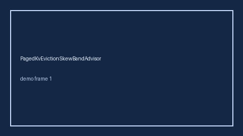

# PagedKvEvictionSkewBandAdvisor Guide



Offline helper.
Gap vs vLLM/SGLang/TGI paged-KV eviction skew monitors. Distinct from `PagedKvSwapThrashAdvisor` / `PagedAttentionFragmentationBandAdvisor`.

Stack: **GPT-5.5 / Claude Sonnet 4.6 / Gemini 3.x / Kimi K2**.

## Usage

```python
from safety.paged_kv_eviction_skew_band import PagedKvEvictionSkewBandAdvisor

advice = PagedKvEvictionSkewBandAdvisor().advise(request_id="req-1", skew_ratio=0.35)
print(advice.band)
```

## Safety

Advisory only. No network I/O. Never auto-acts. Humans decide.
