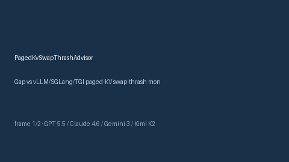

# PagedKvSwapThrashAdvisor Guide



Offline HITL advisor for `swap_thrash_ratio` bands.
Gap vs vLLM/SGLang/TGI paged-KV swap-thrash monitors. Distinct from `PagedAttentionSlotFragmentationAdvisor` / `KvBlockStealAdvisor`.

Stack: **GPT-5.5 / Claude Sonnet 4.6 / Gemini 3.x / Kimi K2**.

## Usage

```python
from safety.paged_kv_swap_thrash import PagedKvSwapThrashAdvisor

advice = PagedKvSwapThrashAdvisor().advise(request_id="r1", swap_thrash_ratio=0.35)
print(advice.band)
```

## Safety

Advisory only. No network I/O. Never auto-acts.
