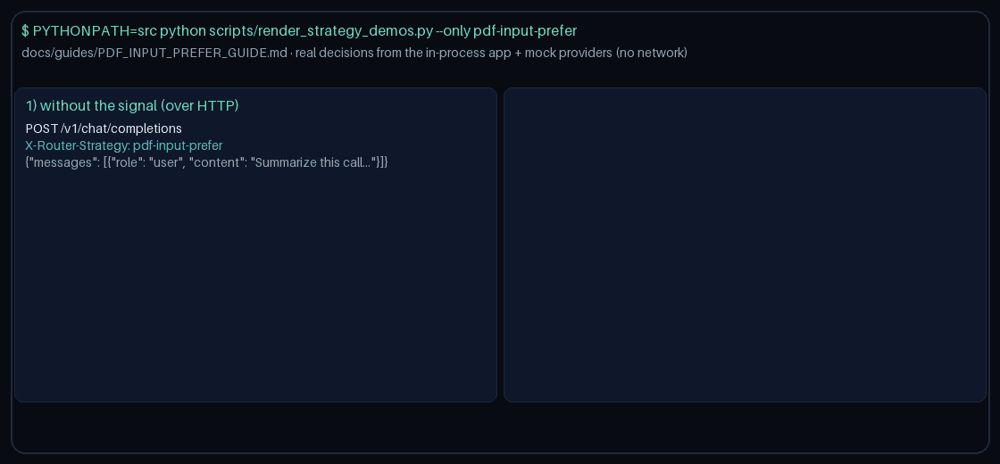

# pdf-input-prefer Guide

Prefer models that advertise `pdf` when the request signals need it.
Works with GPT-6 Astra / Claude Opus 5.5 / Gemini 4 Argon / Kimi K3.1 Pro catalogs.

## Why

OpenRouter / LiteLLM / Portkey video-input capability routing. Gap fill vs OpenRouter/LiteLLM/Portkey capability routing.

## Signals

Truthiness on any of:
- `metadata.requires_pdf`
- `metadata.pdf_input`
- `metadata.has_pdf`

Optional allowlist: `metadata.pdf_models`.

## Capability resolution

1. Allowlist (if provided)
2. `metadata.model_capabilities` / known-model map looking for `pdf`
3. Name heuristic tokens: 'video', 'veo', 'gemini-video'

When the signal is absent, selection stays quality-first.
