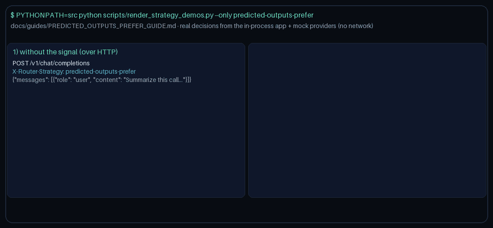

# predicted-outputs-prefer Guide

Prefer models that advertise `predicted_outputs` when the request signals need it.
Works with GPT-6 Astra / Claude Opus 5.5 / Gemini 4 Argon / Kimi K3.1 Pro catalogs.

## Why

OpenAI Predicted Outputs / LiteLLM predicted-output capability routing. Gap fill vs OpenRouter/LiteLLM/Portkey capability routing.

## Signals

Truthiness on any of:
- `metadata.requires_predicted_outputs`
- `metadata.predicted_outputs`
- `metadata.prediction`

Optional allowlist: `metadata.predicted_outputs_models`.

## Capability resolution

1. Allowlist (if provided)
2. `metadata.model_capabilities` / known-model map looking for `predicted_outputs`
3. Name heuristic tokens: 'predicted-outputs', 'prediction', 'predicted'

When the signal is absent, selection stays quality-first.
