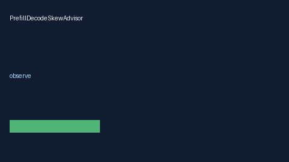

# PrefillDecodeSkewAdvisor Guide



Offline HITL advisor. Never network I/O. Closes gaps vs vLLM/TGI/SGLang prefill/decode skew monitors.

Optional polish via **GPT-5.5 / Claude Sonnet 4.6 / Gemini 3.x / Kimi K2**.

Distinct from `SpeculativeDecodeQueueStallAdvisor` / `BatchCoalescePressureAdvisor`.

## Usage

```python
from safety.prefill_decode_skew import PrefillDecodeSkewAdvisor

advice = PrefillDecodeSkewAdvisor().advise(request_id="r1", skew_ratio=0.15)
print(advice.band)
```
