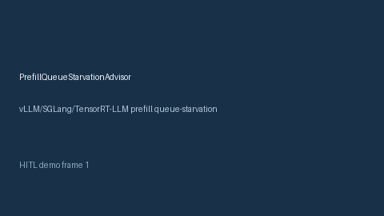

# PrefillQueueStarvationAdvisor Guide



Offline HITL advisor for `starvation_rate` bands. Gap vs vLLM/SGLang/TensorRT-LLM prefill queue-starvation monitors. Distinct from `PrefillDecodeSkewAdvisor` / `PrefillTtftRatioAdvisor`.

Optional polish via **GPT-5.5 / Claude Sonnet 4.6 / Gemini 3.x / Kimi K2**.

## Usage

```python
from safety.prefill_queue_starvation import PrefillQueueStarvationAdvisor

advice = PrefillQueueStarvationAdvisor().advise(request_id="r1", starvation_rate=0.1)
print(advice.band)
```

## Safety

Advisory only. No network I/O. Humans decide.
