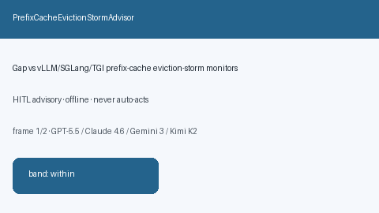

# PrefixCacheEvictionStormAdvisor Guide



Offline HITL `eviction_storm_ratio` bands.
Gap vs vLLM/SGLang/TGI prefix-cache eviction-storm monitors. Distinct from `PrefixCachePoisonAdvisor` / `PrefixCacheThrashAdvisor`.

Stack: **GPT-6 Astra / Claude Opus 5.5 / Gemini 4 Argon / Kimi K3.1 Pro**.

## Usage

```python
from safety.prefix_cache_eviction_storm import PrefixCacheEvictionStormAdvisor

advice = PrefixCacheEvictionStormAdvisor().advise(
    request_id="r1",
    eviction_storm_ratio=0.3,
)
print(advice.band)
```

## Safety

Advisory only. No network I/O. Never auto-acts.
