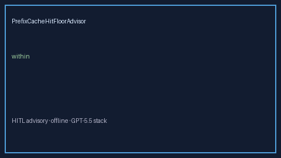

# PrefixCacheHitFloorAdvisor Guide



Offline HITL advisor for `miss_ratio` bands.
Gap vs vLLM/SGLang/TGI prefix-cache hit floor monitors. Distinct from `PrefixCacheThrashAdvisor` / `PrefixCachePoisonAdvisor`.

Optional polish via **GPT-5.5 / Claude Sonnet 4.6 / Gemini 3.x / Kimi K2**.

## Usage

```python
from safety.prefix_cache_hit_floor import PrefixCacheHitFloorAdvisor

advice = PrefixCacheHitFloorAdvisor().advise(request_id="r1", miss_ratio=0.3)
print(advice.band)
```

## Safety

Advisory only. No network I/O. Humans decide.
