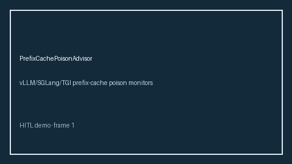

# PrefixCachePoisonAdvisor Guide



Offline advisor. Never network I/O. Gap vs vLLM/SGLang/TGI prefix-cache poison monitors.

Optional polish via **GPT-5.5 / Claude Sonnet 4.6 / Gemini 3.x / Kimi K2**.

Distinct from `PrefixCacheThrashAdvisor` / `KvCacheHitRateAdvisor`.

## Usage

```python
from safety.prefix_cache_poison import PrefixCachePoisonAdvisor

advice = PrefixCachePoisonAdvisor().advise(request_id="r1", poison_hit_rate=0.0)
print(advice.band)
```

## Safety

Advisory bands only. Humans decide.
