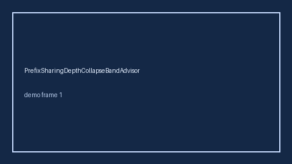

# PrefixSharingDepthCollapseBandAdvisor Guide



Offline helper.
Gap vs vLLM/SGLang/TGI prefix-sharing / radix-cache depth-collapse monitors. Distinct from `SystemPromptShareAdvisor` / `PagedKvSwapThrashAdvisor`.

Stack: **GPT-5.5 / Claude Sonnet 4.6 / Gemini 3.x / Kimi K2**.

## Usage

```python
from safety.prefix_sharing_depth_collapse_band import PrefixSharingDepthCollapseBandAdvisor

advice = PrefixSharingDepthCollapseBandAdvisor().advise(request_id="req-1", collapse_ratio=0.35)
print(advice.band)
```

## Safety

Advisory only. No network I/O. Never auto-acts. Humans decide.
