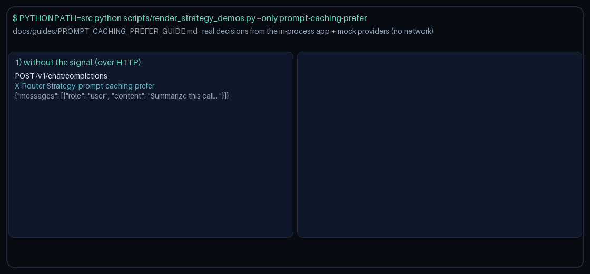

# prompt-caching-prefer Guide

Prefer models that advertise `prompt_caching` when the request signals need it.
Works with GPT-6 Astra / Claude Opus 5.5 / Gemini 4 Argon / Kimi K3.1 Pro catalogs.

## Why

Anthropic/OpenAI prompt caching and Portkey cache-aware routing. Gap fill vs Portkey/LiteLLM prompt-cache capability routing.

## Signals

Truthiness on any of:
- `metadata.requires_prompt_caching`
- `metadata.prompt_caching`
- `metadata.cache_prompt`

Optional allowlist: `metadata.prompt_caching_models`.

> **HTTP note:** strategies read `RouterRequest.metadata`. `POST /v1/chat/completions`,
> `/v1/responses`, and `/v1/messages` do not forward request-body `metadata` to routing
> yet, so over HTTP this strategy takes its no-signal path. Set `metadata` on
> `RouterRequest` when embedding `NexusRouter`, as the demo does
> (`scripts/render_strategy_demos.py`).

## Capability resolution

1. Allowlist (if provided)
2. `metadata.model_capabilities` / known-model map looking for `prompt_caching`
3. Name heuristic tokens: 'prompt-caching', 'prompt-cache', 'cached-tokens'

When the signal is absent, selection stays quality-first.
