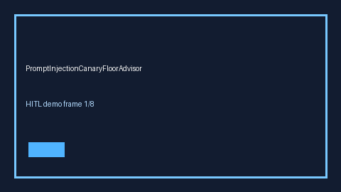

# PromptInjectionCanaryFloorAdvisor Guide



Offline HITL advisor for canary_hit_rate. Gap vs LiteLLM/vLLM/Guardrails prompt-injection canary-floor monitors.

Optional polish via **GPT-5.5 / Claude Sonnet 4.6 / Gemini 3.x / Kimi K2**.

Distinct from `PromptInjectionGateway` / `ProviderCanaryRolloutGuard`.

## Usage

```python
from safety.prompt_injection_canary_floor import PromptInjectionCanaryFloorAdvisor

advice = PromptInjectionCanaryFloorAdvisor().advise(request_id="r1", canary_hit_rate=0.0)
print(advice.band)
```

## Safety

No network I/O. Advisory bands only.
