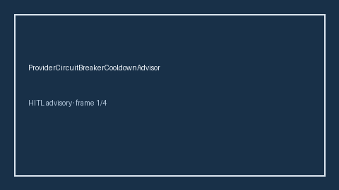

# ProviderCircuitBreakerCooldownAdvisor Guide



Offline HITL advisor. Never network I/O. Closes gaps vs LiteLLM/Portkey/Helicone provider circuit-breaker cooldown monitors.

Optional polish via **GPT-5.5 / Claude Sonnet 4.6 / Gemini 3.x / Kimi K2**.

Distinct from `ProviderHealthHysteresisAdvisor` and `ProviderQuotaRemainingAdvisor`.

## Usage

```python
from safety.provider_circuit_breaker_cooldown import ProviderCircuitBreakerCooldownAdvisor

advice = ProviderCircuitBreakerCooldownAdvisor().advise(request_id="r1", cooldown_ratio=0.15)
print(advice.band)
```
