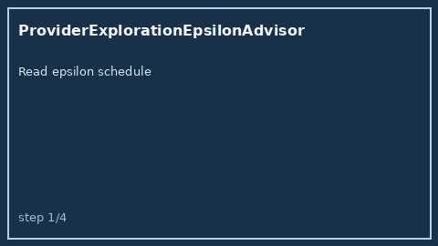

# ProviderExplorationEpsilonAdvisor Guide



Offline advisory control for LLM routing. Never performs network I/O.

Optional polish via **GPT-6 Astra / Claude Opus 5.5 / Gemini 4 Argon / Kimi K3.1 Pro**.

## Usage

```python
from safety.provider_exploration_epsilon import ProviderExplorationEpsilonAdvisor

advice = ProviderExplorationEpsilonAdvisor().advise(epsilon=0.1, sample=0.05)
print(advice.band, advice.explore)
```
