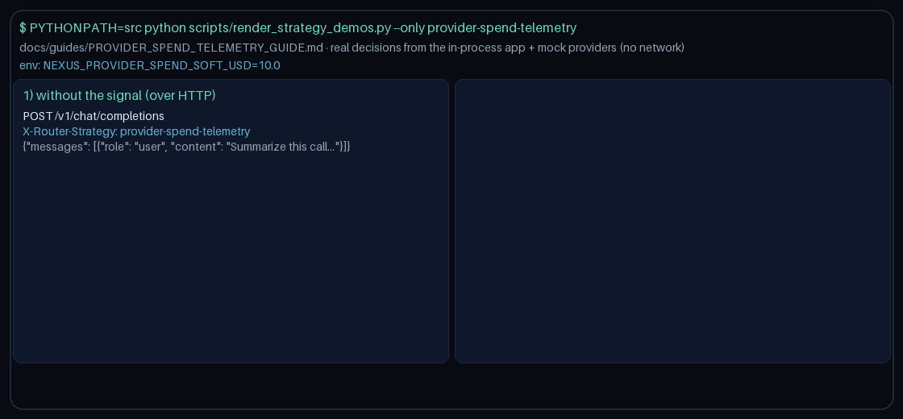

# Provider Spend Telemetry Routing Guide

Prefer lower estimated provider spend once a soft USD threshold is crossed — a gap vs popular gateways (LiteLLM, Portkey) that already expose spend telemetry for **GPT-6 Astra**, **Claude Opus 5.5**, **Gemini 4 Argon**, and **Kimi K3.1 Pro** fleets.



## Usage

```http
X-Router-Strategy: provider-spend-telemetry
```

Pass spend hints in request metadata as `spend:<provider>` (USD). Configure the soft threshold with `NEXUS_PROVIDER_SPEND_SOFT_USD` (default `10.0`).

> **HTTP note:** strategies read `RouterRequest.metadata`. `POST /v1/chat/completions`,
> `/v1/responses`, and `/v1/messages` do not forward request-body `metadata` to routing
> yet, so over HTTP this strategy takes its no-signal path. Set `metadata` on
> `RouterRequest` when embedding `NexusRouter`, as the demo does
> (`scripts/render_strategy_demos.py`).

## Behavior

- Under threshold: quality-first among healthy providers
- At/over threshold: lowest spend, then quality, then estimated token cost
