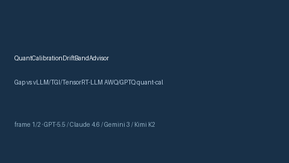

# QuantCalibrationDriftBandAdvisor Guide



Offline HITL advisor for `calib_drift_ratio` bands.
Gap vs vLLM/TGI/TensorRT-LLM AWQ/GPTQ quant-calibration drift monitors. Distinct from `EmbeddingCachePoisonAdvisor` / `TokenizerVocabularyDriftAdvisor`.

Stack: **GPT-5.5 / Claude Sonnet 4.6 / Gemini 3.x / Kimi K2**.

## Usage

```python
from safety.quant_calibration_drift_band import QuantCalibrationDriftBandAdvisor

advice = QuantCalibrationDriftBandAdvisor().advise(request_id="r1", calib_drift_ratio=0.35)
print(advice.band)
```

## Safety

Advisory only. No network I/O. Never auto-acts.
