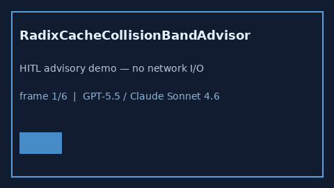

# RadixCacheCollisionBandAdvisor Guide



Offline HITL `collision_ratio` bands.
Gap vs vLLM/SGLang/TGI radix-cache collision monitors. Distinct from `PrefixCacheEvictionStormAdvisor` / `KvBlockStealStormBandAdvisor`.

Stack: **GPT-5.5 / Claude Sonnet 4.6 / Gemini 3.x / Kimi K2**.

## Usage

```python
from safety.radix_cache_collision_band import RadixCacheCollisionBandAdvisor

advice = RadixCacheCollisionBandAdvisor().advise(request_id="r1", collision_ratio=0.3)
print(advice.band)
```

## Safety

Advisory only. No network I/O. Never auto-acts.
