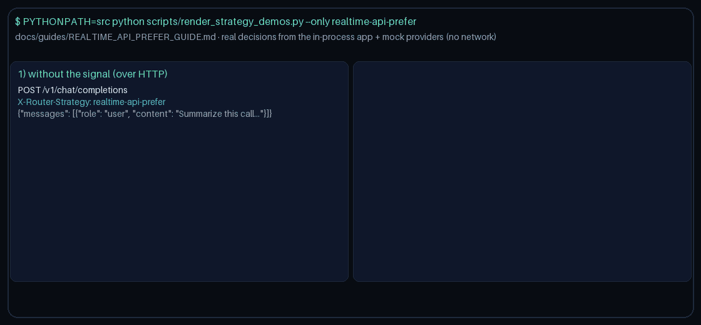

# realtime-api-prefer Guide

Capability-aware routing for GPT-6 Astra / Claude Opus 5.5 / Gemini 4 Argon / Kimi K3.1 Pro.

## Why

OpenAI Realtime API WebSocket streaming for low-latency audio/text conversations.

## Signals

Metadata keys: `requires_realtime`, `realtime_api`, `websocket_streaming`; allowlist `realtime_api_models`.
