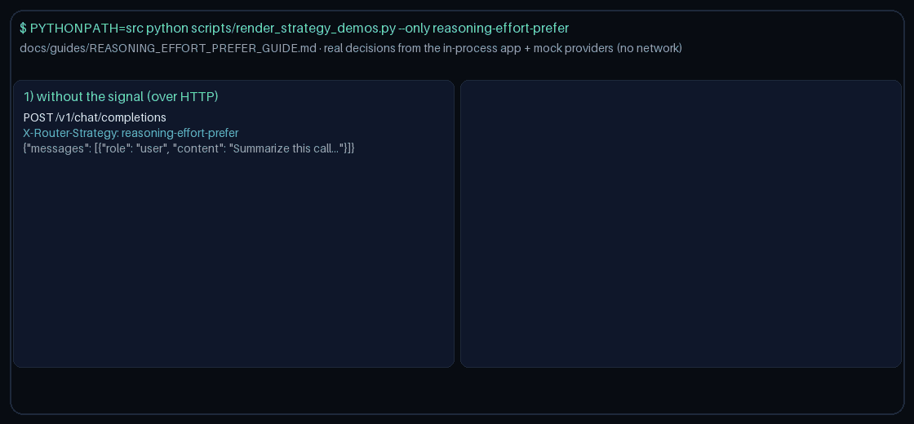

# reasoning-effort-prefer Guide

Prefer models that advertise `reasoning_effort` when the request signals need it.
Works with GPT-6 Astra / Claude Opus 5.5 / Gemini 4 Argon / Kimi K3.1 Pro catalogs.

## Why

OpenAI reasoning-effort controls and LiteLLM/Portkey effort-aware routing. Gap fill vs OpenRouter/LiteLLM/Portkey capability routing.

## Signals

Truthiness on any of:
- `metadata.requires_reasoning_effort`
- `metadata.reasoning_effort`
- `metadata.effort_control`

Optional allowlist: `metadata.reasoning_effort_models`.

> **HTTP note:** strategies read `RouterRequest.metadata`. `POST /v1/chat/completions`,
> `/v1/responses`, and `/v1/messages` do not forward request-body `metadata` to routing
> yet, so over HTTP this strategy takes its no-signal path. Set `metadata` on
> `RouterRequest` when embedding `NexusRouter`, as the demo does
> (`scripts/render_strategy_demos.py`).

## Capability resolution

1. Allowlist (if provided)
2. `metadata.model_capabilities` / known-model map looking for `reasoning_effort`
3. Name heuristic tokens: 'reasoning-effort', 'o3-pro', 'effort-control'

When the signal is absent, selection stays quality-first.
