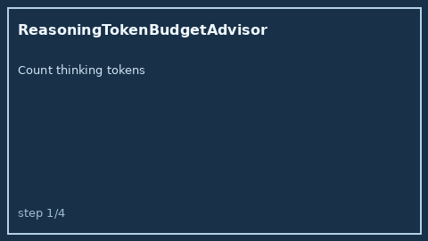

# ReasoningTokenBudgetAdvisor Guide



Offline advisory control for LLM routing. Never performs network I/O.

Optional polish via **GPT-6 Astra / Claude Opus 5.5 / Gemini 4 Argon / Kimi K3.1 Pro**.

## Usage

```python
from safety.reasoning_token_budget import ReasoningTokenBudgetAdvisor

advice = ReasoningTokenBudgetAdvisor().advise(
    reasoning_tokens_used=1900,
    reasoning_token_budget=2000,
)
print(advice.band, advice.remaining)
```
