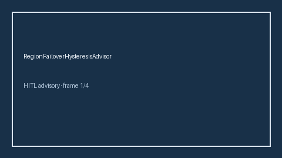

# RegionFailoverHysteresisAdvisor Guide



Offline HITL advisor. Never network I/O. Closes gaps vs LiteLLM/OpenRouter region-failover hysteresis monitors.

Optional polish via **GPT-5.5 / Claude Sonnet 4.6 / Gemini 3.x / Kimi K2**.

Distinct from `ProviderRegionAffinityAdvisor` and `ProviderHealthHysteresisAdvisor`.

## Usage

```python
from safety.region_failover_hysteresis import RegionFailoverHysteresisAdvisor

advice = RegionFailoverHysteresisAdvisor().advise(request_id="r1", failover_score=0.15)
print(advice.band)
```
