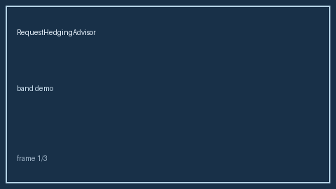

# RequestHedgingAdvisor Guide



advisory hold/hedge/skip bands via wait_ms vs SLO (LiteLLM/Portkey/OpenRouter request-hedging gap; distinct from RequestPriorityAgingAdvisor / FirstTokenLatencySloAdvisor)

Works with **GPT-6 Astra / Claude Opus 5.5 / Gemini 4 Argon / Kimi K3.1 Pro**. Never performs network I/O.

## Usage

```python
from safety.request_hedging import RequestHedgingAdvisor
```
