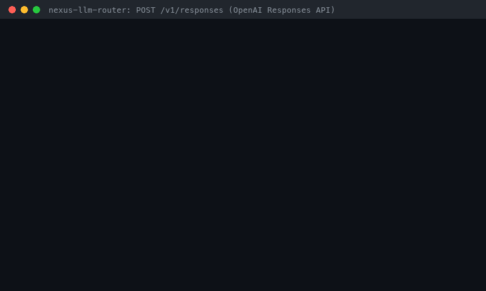

# OpenAI Responses API Guide (`POST /v1/responses`)



Nexus speaks the **OpenAI Responses API** in addition to Chat Completions. Point
any OpenAI SDK at nexus and call `client.responses.create(...)` or
`client.responses.stream(...)`: nexus routes the request with the same
strategies, guards, cache, and spend accounting as `/v1/chat/completions`, and
answers with a Responses-shaped `response` object (or the official SSE event
stream) plus a namespaced `nexus` routing block.

## Why

- **OpenAI made Responses the front door.** The GPT-6 guide says "set `model`
  in a Responses API request", and tool calling on GPT-6.1 Sol / GPT-6.1 Terra
  / GPT-6 Astra requires Responses
  ([latest-model guide](https://developers.openai.com/api/docs/guides/latest-model)).
  New SDK code increasingly calls `client.responses.create`, not
  `client.chat.completions.create`.
- **Other gateways already bridge it.** The
  [LiteLLM proxy](https://docs.litellm.ai/docs/response_api) (BerriAI/litellm)
  exposes `/v1/responses` for every provider, bridging through Chat Completions
  where a provider has no native support, and
  [OpenRouter](https://openrouter.ai/docs/api_reference/responses/overview)
  exposes a stateless, OpenAI-compatible `/api/v1/responses` that rejects
  `store: true` and `previous_response_id` with a 400, the same contract nexus
  follows.
- **The gap this closes.** Nexus only spoke Chat Completions, so an OpenAI SDK
  user calling `client.responses.create(...)` against nexus got a `404`. Now the
  same client works unchanged, and nexus still decides which provider model
  serves the request.

## Quickstart

Run nexus with real provider keys (`.env`, see [QUICKSTART](../../QUICKSTART.md))
or fully offline with deterministic mock providers:

```bash
PYTHONPATH=src uvicorn api.main:app --port 8000            # real providers
PYTHONPATH=src python scripts/serve_mock.py --port 8000     # mock providers, no keys
```

### curl

```bash
curl -s http://localhost:8000/v1/responses \
  -H 'Content-Type: application/json' \
  -H 'Authorization: Bearer <your-nexus-key>' \
  -H 'X-Router-Strategy: cost-optimal' \
  -d '{
    "instructions": "You are a terse support agent.",
    "input": "Summarize our refund policy in one line.",
    "max_output_tokens": 256,
    "metadata": {"ticket": "T-42"}
  }'
```

Real response from the mock-provider server (`scripts/serve_mock.py`); echo-only
fields such as `text`, `tools`, and `truncation` are trimmed:

```json
{
  "id": "resp_1abf480f9854405e9feceb5f9a40e84a",
  "object": "response",
  "created_at": 1794034918,
  "status": "completed",
  "completed_at": 1794034918,
  "error": null,
  "incomplete_details": null,
  "instructions": "You are a terse support agent.",
  "max_output_tokens": 256,
  "model": "gpt-4.1-mini",
  "output": [
    {
      "id": "msg_feb2506b855945abaf058653728b1869",
      "type": "message",
      "status": "completed",
      "role": "assistant",
      "content": [
        {
          "type": "output_text",
          "text": "[gpt-4.1-mini] routed response",
          "annotations": [],
          "logprobs": []
        }
      ]
    }
  ],
  "store": false,
  "temperature": 1.0,
  "usage": {
    "input_tokens": 17,
    "input_tokens_details": {"cached_tokens": 0},
    "output_tokens": 16,
    "output_tokens_details": {"reasoning_tokens": 0},
    "total_tokens": 33
  },
  "metadata": {"ticket": "T-42"},
  "nexus": {
    "routing_strategy": "cost-optimal",
    "rationale": "LP objective minimized estimated cost $0.000208 with quality floor 0.72",
    "cost_usd": 0.000033,
    "latency_ms": 0.1088753342628479,
    "request_id": "da0c43750f464b33aad9713d8687dc95"
  }
}
```

### Official OpenAI Python SDK

```python
from openai import OpenAI

client = OpenAI(base_url="http://localhost:8000/v1", api_key="<your-nexus-key>")

response = client.responses.create(
    model="gpt-6.1-sol",  # a routing hint, see "Choosing a model"
    instructions="You are a terse support agent.",
    input="Summarize our refund policy in one line.",
    extra_headers={"X-Router-Strategy": "cost-optimal"},
)
print(response.output_text)
print(response.model)                   # model nexus actually used
print(response.model_extra["nexus"])    # routing strategy, rationale, cost, latency
```

Multi-turn conversations are stateless: resend earlier turns in `input`
(including the assistant `output` items you received) instead of using
`previous_response_id`:

```python
history = [
    {"role": "developer", "content": "Cite the policy section."},
    {"role": "user", "content": [{"type": "input_text", "text": "Can I return shoes after 40 days?"}]},
]
first = client.responses.create(model="gpt-6.1-sol", input=history)
history += [item.model_dump() for item in first.output]
history.append({"role": "user", "content": "And sandals?"})
second = client.responses.create(model="gpt-6.1-sol", input=history)
```

## Streaming

Set `stream: true` (or use `client.responses.stream(...)`). Nexus emits
`event:` + `data:` SSE frames in the official order, with a `sequence_number`
that starts at `0` and increases by one per event. There is no `data: [DONE]`
sentinel; the stream ends after the terminal event.

| # | Event | Payload highlights |
| --- | --- | --- |
| 1 | `response.created` | `response` with `status: "in_progress"`, empty `output`, `usage: null` |
| 2 | `response.in_progress` | same `response` snapshot |
| 3 | `response.output_item.added` | `output_index: 0`, assistant `message` item with `content: []` |
| 4 | `response.content_part.added` | `item_id`, `content_index: 0`, empty `output_text` part |
| 5+ | `response.output_text.delta` | `item_id`, `output_index`, `content_index`, `delta`, `logprobs: []` |
| … | `response.output_text.done` | full `text` |
| … | `response.content_part.done` | final `output_text` part |
| … | `response.output_item.done` | completed `message` item |
| last | `response.completed` | full `response` incl. `usage` and `nexus` metadata |

```python
with client.responses.stream(model="auto", input="Stream a status update.") as stream:
    for event in stream:
        if event.type == "response.output_text.delta":
            print(event.delta, end="", flush=True)
    final = stream.get_final_response()
print(final.usage.total_tokens)
```

The SDK's `responses.stream()` helper insists on a `model` client-side; any ID
that is not in the nexus catalog (such as `"auto"`) lets the strategy choose.

Failure semantics:

- Routing failures **before the first output text** (rate limit, every provider
  failed) are returned as normal HTTP errors (see [Errors](#errors)), exactly
  like non-streaming requests: nexus pulls the stream until its first non-empty
  chunk before it starts the event stream. Provider failures before any text
  still fall back to the next candidate.
- Once text has streamed, nexus **never falls back**: a second provider's
  answer would be spliced onto the partial one. A provider failure then ends
  the stream with a single `response.failed` event: `response.status:
  "failed"`, the partial text in an `incomplete` output item, and
  `response.error = {code, message, type}` where `code` is
  `rate_limit_exceeded` or `server_error` and `type` is the nexus category
  (`rate_limit_error`, `budget_exceeded`, `routing_failed`).

## Supported request fields

Nexus implements a documented, text-only subset of
[`POST /responses`](https://developers.openai.com/api/reference/resources/responses/methods/create).
Unknown fields are **ignored** (same as `/v1/chat/completions`); known
Responses features that nexus cannot honor are **rejected** with a 400 instead
of being silently dropped.

| Field | Status | Behavior in nexus |
| --- | --- | --- |
| `model` | Supported | Routing hint, same semantics as Chat Completions `model` (see below); `response.model` reports the model used. |
| `input` (string) | Supported | One `user` message. Required. |
| `input` (array of message items) | Supported | Roles `user`, `assistant`, `system`, `developer` (`developer` → system). `content` is a string or `input_text` parts; replayed assistant `output_text` / `refusal` parts are accepted. Multiple parts are joined with newlines. |
| `instructions` | Supported | Prepended as a system message; echoed back. |
| `max_output_tokens` | Supported | Router `max_tokens`; must be ≥ 16 like OpenAI. Defaults to 512 (the Chat Completions default) when omitted; echoed as sent. |
| `temperature` | Accepted | Validated (0–2), echoed, and part of the response-cache key. Like `/v1/chat/completions`, nexus adapters do not forward sampling parameters to providers today, which also keeps fixed-temperature models (Kimi K3.x requires `1.0`) safe. |
| `stream` | Supported | Official SSE event sequence (above). |
| `user`, `safety_identifier` | Supported | End-user id for budgets, spend, cache scope (`safety_identifier` wins); echoed. Never forwarded to providers. |
| `metadata` | Supported | ≤ 16 string pairs (64-char keys, 512-char values); echoed only, never used for routing. |
| `store` | `false` only | Nexus never stores responses; omitted means `false`, `true` → 400. |
| `background` | `false` only | Needs stored responses → `true` → 400. |
| `previous_response_id`, `conversation` | Rejected | Stateless; resend history in `input`. |
| `tools` (non-empty), `tool_choice` (other than `auto`/`none`) | Rejected | Tool calling is not routed by this endpoint yet. |
| `prompt` | Rejected | Prompt templates are not stored; send rendered text. |
| `text.format` other than `{"type": "text"}` | Rejected | No structured outputs (`json_schema` / `json_object`); malformed formats are rejected too rather than answered as plain text. |
| `input_image`, `input_file`, `input_audio` parts | Rejected | Nexus routes text-only messages. |
| Non-message input items (`function_call_output`, `item_reference`, `reasoning`, …) | Rejected | Text messages only. |
| `top_p`, `reasoning`, `include`, `truncation`, `service_tier`, `parallel_tool_calls`, `prompt_cache_key`, `stream_options`, other unknown fields | Ignored | Accepted for SDK compatibility, not applied. |

## Headers

| Header | Behavior |
| --- | --- |
| `Authorization` | Never used verbatim: nexus derives a non-reversible `key_<16 hex>` fingerprint for per-key rate limits, budgets, cache and idempotency scopes (see [SECURITY.md](../../SECURITY.md#credential-handling)). |
| `X-Router-Strategy` | Any [routing strategy](../../CONFIGURATION.md) name; unknown names → 400 `invalid_value` with `param: "X-Router-Strategy"`. |
| `X-Tenant-Id` | Optional hard per-tenant token bucket (`NEXUS_TENANT_RATE_LIMIT_*`), checked before routing. |
| `Idempotency-Key` | Non-streaming requests only: a retry with the same key and tenant replays the stored `response` verbatim. Keys are scoped per endpoint, so a Responses key never replays a Chat Completions body or vice versa (whatever the key spells). Ignored when `stream: true`. |

Non-streaming requests also use the exact-match response cache (shared with
Chat Completions, keyed on messages, model, temperature, `max_output_tokens`,
strategy, and tenant), so an identical retry is served without a provider call.

## Errors

All `/v1/responses` errors use the OpenAI envelope
`{"error": {"message", "type", "param", "code"}}`, so SDKs raise their usual
typed exceptions (`BadRequestError`, `RateLimitError`, …).

| HTTP | `type` | `code` | When |
| --- | --- | --- | --- |
| 400 | `invalid_request_error` | `unsupported_parameter` | A rejected feature from the table above (`param` names it). |
| 400 | `invalid_request_error` | `unsupported_value` | Non-text content part or non-message input item (`param` like `input[0].content[1].type`). |
| 400 | `invalid_request_error` | `missing_required_parameter` / `empty_array` / `invalid_value` / `invalid_type` | Missing or empty `input`, out-of-range values, bad roles or types, unknown `X-Router-Strategy`. |
| 400 | `invalid_request_error` | `null` | Body is not valid JSON. |
| 429 | `rate_limit_error` | `rate_limit_exceeded` | Per-key router rate limit or `X-Tenant-Id` bucket exhausted. |
| 402 | `budget_exceeded` | `budget_exceeded` | Budget guardrail rejected the request. |
| 503 | `routing_failed` | `routing_failed` | Every provider attempt in the fallback chain failed (including candidates skipped by the budget cap). |

Other routes keep their existing error formats (`/v1/chat/completions` still
returns FastAPI `{"detail": ...}` bodies and 422 validation errors).

## Routing metadata

Every completed response carries a namespaced `nexus` object that OpenAI SDKs
keep as an extra field (`response.model_extra["nexus"]` in Python):

| Field | Meaning |
| --- | --- |
| `routing_strategy` | Strategy that chose the model (`X-Router-Strategy` or `NEXUS_DEFAULT_STRATEGY`). |
| `rationale` | Human-readable reason, including fallback attempts. |
| `cost_usd` | Estimated provider cost of this call. |
| `latency_ms` | End-to-end routing + provider latency. |
| `request_id` | Router request id, also used in the audit log and spend ledger. |

`usage.input_tokens_details.cached_tokens` and
`usage.output_tokens_details.reasoning_tokens` are reported as `0` because
adapters do not surface provider cache/reasoning counters yet.

## Known limitations

- **Truncation is not reported.** `status` is always `completed` with
  `incomplete_details: null`, even when `max_output_tokens` cut the answer
  short, because nexus adapters do not surface provider stop reasons yet
  (`/v1/chat/completions` likewise always reports `finish_reason: "stop"`).
  Propagating them (OpenAI/Kimi `length`, Anthropic `max_tokens`, Gemini
  `MAX_TOKENS`) is planned as a separate change for both endpoints.
- **Text only, stateless.** No tools, structured outputs, multimodal parts,
  stored responses, or `GET`/`DELETE /v1/responses/{id}` (see the field table).
- **Sampling parameters are not forwarded** to providers (`temperature` is
  validated, echoed, and cached on; `top_p` is ignored).
- **Token details are zero.** `cached_tokens` and `reasoning_tokens` are not
  reported by adapters yet.
- **Streaming usage is estimated.** Adapter `stream()` methods yield text only,
  so `response.completed.usage` (and the spend ledger entry) for streams uses
  the router's estimate (prompt estimate in, about 4 characters per output
  token) rather than provider-reported counts; non-streaming usage is
  provider-reported. The stop-reason follow-up above will carry provider usage
  through streams as well.
- **Idempotency replays completed responses only.** A retry that arrives while
  the original request is still in flight is routed again (same as
  `/v1/chat/completions` today); keys are not reserved before routing yet.

## Choosing a model

`model` is optional. Nexus treats it exactly like Chat Completions `model`: a
hint that pins the request when the ID exists in the active catalog
(`src/router/model_ids.py` / `default_model_catalog()`) and the strategy honors
explicit requests (`rule-based` does for prompts no stronger rule claims).
Otherwise the strategy decides, and `response.model` always reports the model
that actually served the request.

Current provider models (verified against provider docs on 2026-11-06):

| Provider | Model IDs (newest first) | Typical use |
| --- | --- | --- |
| OpenAI | `gpt-6-astra`, `gpt-6.1-sol`, `gpt-6.1-terra`, `gpt-6-luna` | Astra: hardest tasks; Sol: balanced default; Terra: fast/efficient; Luna: cheapest. ([models](https://developers.openai.com/api/docs/models)) |
| Anthropic | `claude-fable-5-1`, `claude-opus-5-5`, `claude-sonnet-5-5`, `claude-haiku-5-5` | Opus: recommended default; Haiku: routing/classification. ([models](https://platform.claude.com/docs/en/models/overview)) |
| Google | `gemini-4-argon`, `gemini-3.8-flash` | Argon: flagship reasoning; 3.8 Flash: fast default. ([models](https://aistudio.google.com/docs/models)) |
| Kimi (Moonshot) | `kimi-k3.1-pro`, `kimi-k3.1-pro-highspeed` | 1M-context flagship; temperature fixed at 1.0. ([models](https://platform.kimi.ai/docs/api/models-overview.md)) |

Examples with the OpenAI SDK:

```python
# Ask for GPT-6.1 Sol (balanced) and let nexus fall back if its provider fails.
client.responses.create(model="gpt-6.1-sol", input="Draft a migration plan for billing.")

# Ask for Claude Opus 5.5 on a legal review, routed by the rule-based strategy.
client.responses.create(
    model="claude-opus-5-5",
    input="Review this contract clause for indemnity risk.",
    extra_headers={"X-Router-Strategy": "rule-based"},
)

# Ask for Kimi K3.1 Pro Highspeed for a quick yes/no classification.
client.responses.create(
    model="kimi-k3.1-pro-highspeed",
    instructions="Answer yes or no.",
    input="Is this a refund request?",
)
```

Short prompts like the last one are claimed by the `rule-based` "simple
realtime prompt" rule before an explicit model is considered, and IDs that are
not in your catalog are never pinned, so always read `response.model` (and
`response.model_extra["nexus"]["rationale"]`) to see what ran and why.

## Nexus vs LiteLLM vs OpenRouter

| Capability | LiteLLM proxy | OpenRouter | Nexus `/v1/responses` |
| --- | --- | --- | --- |
| OpenAI-compatible `POST /v1/responses` | Yes (since v1.63.8) | Yes (`/api/v1/responses`) | Yes |
| Streaming | Yes | Yes | Yes (official lifecycle with `sequence_number`) |
| Stored responses (`store`, `previous_response_id`, GET/DELETE) | Yes | No, stateless (400) | No, stateless (400) |
| Tool calling | Yes | Yes | Not yet (explicit 400) |
| Multi-provider routing | Load balancing and fallbacks across deployments | Provider routing | 100+ task-aware strategies selectable per request via `X-Router-Strategy` |

What nexus adds on top of compatibility: every response explains its routing
decision in the `nexus` block (strategy, rationale, cost, latency, request id),
non-streaming requests can be retried safely with `Idempotency-Key`, and the
same API key fingerprint, tenant limits, budgets, spend ledger, and response
cache apply to both `/v1/chat/completions` and `/v1/responses`.

## How this demo was recorded

The GIF is rendered from a real terminal session against mock providers (no API
keys). Model names in the recording are whatever this build's routing strategy
picked from its catalog; mock providers answer `[model] routed response`.

```bash
source .venv/bin/activate
PYTHONPATH=src python scripts/serve_mock.py --port 8765 > /dev/null 2>&1 &
curl -s localhost:8765/v1/responses -H 'content-type: application/json' \
  -H 'X-Router-Strategy: cost-optimal' \
  -d '{"instructions":"Be terse.","input":"Summarize the refund policy.","metadata":{"ticket":"T-42"}}' \
  | jq -c '{id, status, model, text: .output[0].content[0].text, strategy: .nexus.routing_strategy}'
uv run --quiet --no-project --with openai python scripts/responses_api_demo.py --base-url http://localhost:8765/v1
```

The transcript was rendered with the shared transcript renderer
(`--rows 22 --type-steps 4 --font-size 13`). `scripts/responses_api_demo.py`
uses the official `openai` package (3.46.0 at recording time) for
`responses.create`, raw `stream=True` iteration, `responses.stream()` with
`get_final_response()`, and a `BadRequestError` for an unsupported field.

<details>
<summary>Full transcript</summary>

```text
$ PYTHONPATH=src python scripts/serve_mock.py --port 8765 > /dev/null 2>&1 &
$ curl -s localhost:8765/v1/responses -H 'content-type: application/json' -H 'X-Router-Strategy: cost-optimal' -d '{"instructions":"Be terse.","input":"Summarize the refund policy.","metadata":{"ticket":"T-42"}}' | jq -c '{id, status, model, text: .output[0].content[0].text, strategy: .nexus.routing_strategy}'
{"id":"resp_354aae395e3d45169c162d3577fd78f7","status":"completed","model":"gpt-4.1-mini","text":"[gpt-4.1-mini] routed response","strategy":"cost-optimal"}
$ uv run --quiet --no-project --with openai python scripts/responses_api_demo.py --base-url http://localhost:8765/v1
create: resp_0b8be539... completed model=gpt-4.1-mini
  output_text='[gpt-4.1-mini] routed response' metadata={'ticket': 'T-42'}
  usage in=17 out=16 total=33 | nexus strategy=cost-optimal cost_usd=0.000033
stream=True events (sequence_number:type):
  0:response.created 1:response.in_progress 2:response.output_item.added
  3:response.content_part.added 4:response.output_text.delta 5:response.output_text.delta
  6:response.output_text.delta 7:response.output_text.done 8:response.content_part.done
  9:response.output_item.done 10:response.completed
  deltas=['[gemini-3.5-flash] ', 'routed ', 'response']
responses.stream(): '[gemini-3.5-flash] routed response' total_tokens=13
unsupported: HTTP 400 code=unsupported_parameter param=previous_response_id
```

</details>

## Tests

```bash
pytest tests/test_responses_api.py -v
```

Covers string and message-list input (parts, `developer` role, replayed
assistant output, `instructions`), every rejected feature, non-text parts,
validation envelopes, streaming order / sequence numbers / final usage,
`response.failed`, HTTP errors before the first token (including empty first
chunks), no fallback splicing after text streamed (real `NexusRouter` with a
provider that fails mid-stream) while pre-output failures still fall back,
empty-but-successful streams, 429/402/503 mapping, `X-Router-Strategy`,
`X-Tenant-Id`, the API key fingerprint, idempotent replay with collision-free
per-endpoint scopes, and response-cache reuse.
