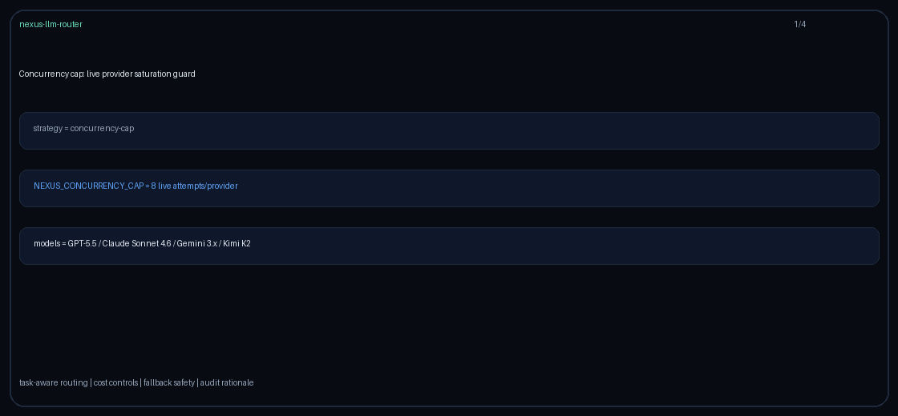

# responses-api-prefer Guide

Capability-aware routing for GPT-6 Astra / Claude Opus 5.5 / Gemini 4 Argon / Kimi K3.1 Pro.

## Why

OpenAI Responses API routing in LiteLLM/Portkey capability routers.

## Signals

Metadata keys: `requires_responses_api`, `responses_api`, `responses`; allowlist `responses_api_models`.
