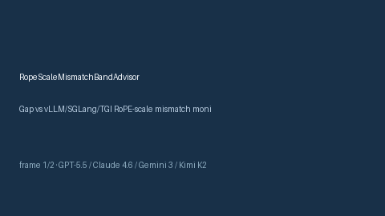

# RopeScaleMismatchBandAdvisor Guide



Offline HITL advisor for `rope_mismatch_ratio` bands.
Gap vs vLLM/SGLang/TGI RoPE-scale mismatch monitors. Distinct from `TokenizerBpeMergeStormAdvisor` / `ContextWindowFragmentationAdvisor`.

Stack: **GPT-5.5 / Claude Sonnet 4.6 / Gemini 3.x / Kimi K2**.

## Usage

```python
from safety.rope_scale_mismatch_band import RopeScaleMismatchBandAdvisor

advice = RopeScaleMismatchBandAdvisor().advise(request_id="r1", rope_mismatch_ratio=0.35)
print(advice.band)
```

## Safety

Advisory only. No network I/O. Never auto-acts.
