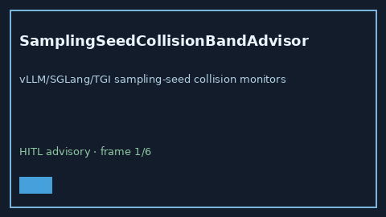

# SamplingSeedCollisionBandAdvisor Guide



Offline HITL `collision_ratio` bands.
Gap vs vLLM/SGLang/TGI sampling-seed collision monitors. Distinct from `DraftVerifyMismatchBandAdvisor` / `QuantCalibrationDriftBandAdvisor`.

Stack: **GPT-6 Astra / Claude Opus 5.5 / Gemini 4 Argon / Kimi K3.1 Pro**.

## Usage

```python
from safety.sampling_seed_collision_band import SamplingSeedCollisionBandAdvisor

advice = SamplingSeedCollisionBandAdvisor().advise(request_id="r1", collision_ratio=0.3)
print(advice.band)
```

## Safety

Advisory only. No network I/O. Never auto-acts. Humans decide.
