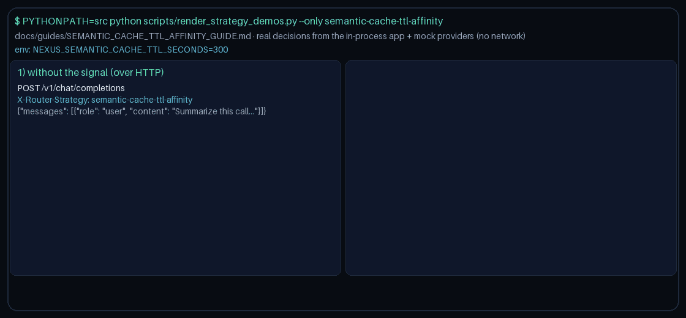

# Semantic-Cache TTL Affinity Routing Guide

Pin cacheable requests to providers with warm semantic-cache TTL remaining — a feature gap vs GPTCache / LiteLLM cache sticky routing for **GPT-6 Astra**, **Claude Opus 5.5**, **Gemini 4 Argon**, and **Kimi K3.1 Pro**.



## Usage

```http
X-Router-Strategy: semantic-cache-ttl-affinity
```

Metadata: `cacheable=true` plus `cache_ttl_remaining:<provider>` (seconds). Window via `NEXUS_SEMANTIC_CACHE_TTL_SECONDS` (default `300`).

> **HTTP note:** strategies read `RouterRequest.metadata`. `POST /v1/chat/completions`,
> `/v1/responses`, and `/v1/messages` do not forward request-body `metadata` to routing
> yet, so over HTTP this strategy takes its no-signal path. Set `metadata` on
> `RouterRequest` when embedding `NexusRouter`, as the demo does
> (`scripts/render_strategy_demos.py`).
