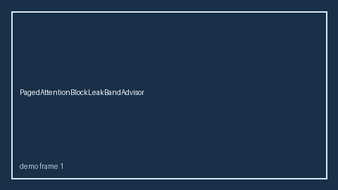

# SpeculativeAcceptanceCollapseBandAdvisor Guide



Offline HITL `collapse_ratio` bands.
Gap vs vLLM/SGLang/TGI speculative acceptance-collapse monitors. Distinct from `SpeculativeAcceptanceEntropyBandAdvisor` / `SpeculativeDraftStarveBandAdvisor`.

Stack: **GPT-6 Astra / Claude Opus 5.5 / Gemini 4 Argon / Kimi K3.1 Pro**.

## Usage

```python
from safety.speculative_acceptance_collapse_band import SpeculativeAcceptanceCollapseBandAdvisor

advice = SpeculativeAcceptanceCollapseBandAdvisor().advise(request_id="req-1", collapse_ratio=0.15)
print(advice.band)
```

## Safety

Advisory only. No network I/O.
