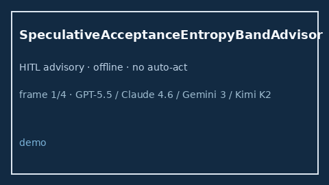

# SpeculativeAcceptanceEntropyBandAdvisor Guide



Offline HITL `entropy_ratio` bands.
Gap vs vLLM/SGLang/TGI speculative acceptance-entropy monitors. Distinct from `SpeculativeDecodeAcceptanceBandAdvisor` / `SpeculativeDecodeRejectionHysteresisAdvisor`.

Stack: **GPT-6 Astra / Claude Opus 5.5 / Gemini 4 Argon / Kimi K3.1 Pro**.

## Usage

```python
from safety.speculative_acceptance_entropy_band import SpeculativeAcceptanceEntropyBandAdvisor

advice = SpeculativeAcceptanceEntropyBandAdvisor().advise(request_id="r1", entropy_ratio=0.3)
print(advice.band)
```

## Safety

Advisory only. No network I/O.
