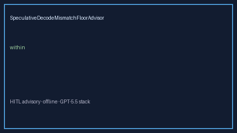

# SpeculativeDecodeMismatchFloorAdvisor Guide



Offline HITL advisor for `mismatch_ratio` bands.
Gap vs vLLM/SGLang speculative-decode mismatch floor monitors. Distinct from `SpeculativeDecodeAcceptanceAdvisor` / `SpeculativeDecodeRejectionStormAdvisor`.

Optional polish via **GPT-5.5 / Claude Sonnet 4.6 / Gemini 3.x / Kimi K2**.

## Usage

```python
from safety.speculative_decode_mismatch_floor import SpeculativeDecodeMismatchFloorAdvisor

advice = SpeculativeDecodeMismatchFloorAdvisor().advise(request_id="r1", mismatch_ratio=0.3)
print(advice.band)
```

## Safety

Advisory only. No network I/O. Humans decide.
