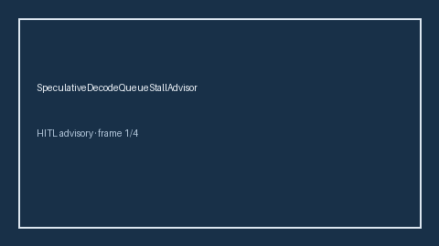

# SpeculativeDecodeQueueStallAdvisor Guide



Offline HITL advisor. Never network I/O. Closes gaps vs vLLM/TGI/OpenAI-compatible speculative-decode queue-stall monitors.

Optional polish via **GPT-5.5 / Claude Sonnet 4.6 / Gemini 3.x / Kimi K2**.

Distinct from `SpeculativeDecodeRejectionStormAdvisor` and `SpeculativeDecodeAbortAdvisor`.

## Usage

```python
from safety.speculative_decode_queue_stall import SpeculativeDecodeQueueStallAdvisor

advice = SpeculativeDecodeQueueStallAdvisor().advise(request_id="r1", stall_ratio=0.15)
print(advice.band)
```
