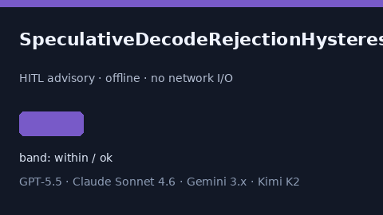

# SpeculativeDecodeRejectionHysteresisAdvisor Guide



Offline HITL helper for `hysteresis_ratio` bands.
Gap vs vLLM/SGLang/TGI speculative-decode rejection-hysteresis monitors. Distinct from `SpeculativeDecodeRejectionStormAdvisor` / `ContinuousBatchPreemptionChurnAdvisor`.

Optional polish via **GPT-5.5 / Claude Sonnet 4.6 / Gemini 3.x / Kimi K2**.

## Usage

```python
from safety.speculative_decode_rejection_hysteresis import (
    SpeculativeDecodeRejectionHysteresisAdvisor,
)

advice = SpeculativeDecodeRejectionHysteresisAdvisor().advise(
    request_id="r1", hysteresis_ratio=0.35
)
print(advice.band)
```

## Safety

Advisory only. No network I/O. Never auto-acts. Humans decide.
