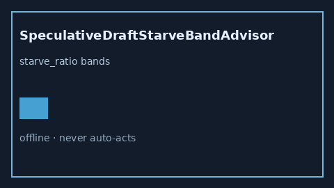

# SpeculativeDraftStarveBandAdvisor Guide



Offline HITL helper for `starve_ratio` bands.
Gap vs vLLM/SGLang/TGI speculative draft-starve monitors. Distinct from `SpeculativeTreeDepthBlowupAdvisor` / `SpeculativeAcceptanceEntropyBandAdvisor`.

Stack: **GPT-5.5 / Claude Sonnet 4.6 / Gemini 3.x / Kimi K2**.

## Usage

```python
from safety.speculative_draft_starve_band import SpeculativeDraftStarveBandAdvisor

advice = SpeculativeDraftStarveBandAdvisor().advise(request_id="r1", starve_ratio=0.3)
print(advice.band)
```

## Safety

Advisory only. No network I/O. Never auto-acts.
