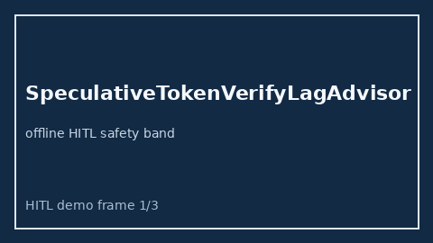

# SpeculativeTokenVerifyLagAdvisor Guide



Offline HITL advisor for `verify_lag_ms` bands.
Gap vs vLLM/SGLang/TGI speculative-token verify-lag monitors. Distinct from `SpeculativeDecodeMismatchFloorAdvisor` / `SpeculativeDecodeRejectionStormAdvisor`.

Optional polish via **GPT-5.5 / Claude Sonnet 4.6 / Gemini 3.x / Kimi K2**.

## Usage

```python
from safety.speculative_token_verify_lag import SpeculativeTokenVerifyLagAdvisor

advice = SpeculativeTokenVerifyLagAdvisor().advise(request_id="r1", verify_lag_ms=40.0)
print(advice.band)
```

## Safety

Advisory only. No network I/O. Humans decide.
