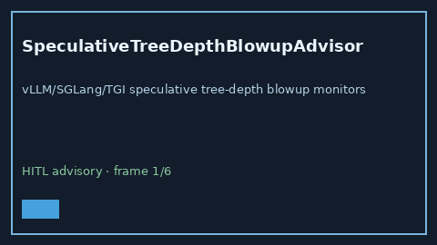

# SpeculativeTreeDepthBlowupAdvisor Guide



Offline HITL `depth_blowup_ratio` bands.
Gap vs vLLM/SGLang/TGI speculative tree-depth blowup monitors. Distinct from `SpeculativeDecodeRejectionHysteresisAdvisor` / `GuidedDecodeFsmBlowupAdvisor`.

Stack: **GPT-5.5 / Claude Sonnet 4.6 / Gemini 3.x / Kimi K2**.

## Usage

```python
from safety.speculative_tree_depth_blowup import SpeculativeTreeDepthBlowupAdvisor

advice = SpeculativeTreeDepthBlowupAdvisor().advise(request_id="r1", depth_blowup_ratio=0.3)
print(advice.band)
```

## Safety

Advisory only. No network I/O. Never auto-acts. Humans decide.
