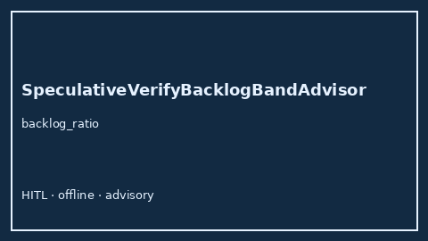

# SpeculativeVerifyBacklogBandAdvisor Guide



Offline HITL `backlog_ratio` band advisor.
Gap vs vLLM/SGLang/TGI speculative verify backlog monitors. Distinct from `SpeculativeDecodeQueueStallAdvisor` / `SpeculativeDraftStarveBandAdvisor`.

Stack: **GPT-5.5 / Claude Sonnet 4.6 / Gemini 3.x / Kimi K2**.

## Usage

```python
from safety.speculative_verify_backlog_band import SpeculativeVerifyBacklogBandAdvisor

advice = SpeculativeVerifyBacklogBandAdvisor().advise(request_id="req-1", backlog_ratio=0.35)
print(advice.band)
```

## Safety

Advisory only. No network I/O.
