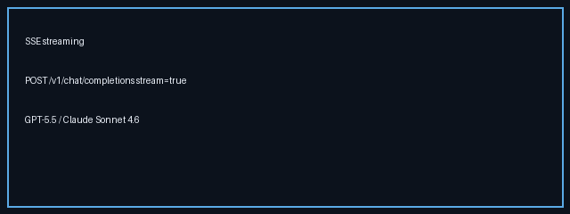

# SSE Streaming Guide



OpenAI-compatible Server-Sent Events (SSE) for `POST /v1/chat/completions`
when `stream=true`. Closes the gap versus OpenRouter / LiteLLM, which stream by
default for GPT-6 / Claude Opus 5.5 / Gemini 4 / Kimi K3.1.

## Why

Token streaming is table stakes for chat UIs. Nexus adapters already exposed
`stream()`; this wires `NexusRouter.complete_stream` and the API path so clients
receive `text/event-stream` chunks instead of a hard 400.

## How it works

1. Request arrives with `"stream": true`.
2. Router selects a model with the configured strategy (same Observe→Decide path).
3. The chosen provider adapter's `stream()` yields text chunks, then its final
   response (provider-reported usage, cost, and stop reason).
4. The API frames each chunk as an OpenAI `chat.completion.chunk` SSE event.
5. A final chunk carries the provider stop reason (`finish_reason=stop`, or
   `length` when `max_tokens` cut the answer) and is followed by `data: [DONE]`.

## Failure semantics

Provider failures **before any text** was streamed fall back to the next
candidate as usual. Once a chunk with text has been sent, nexus no longer falls
back (that would splice a second model's answer onto the partial one): the
stream ends with `data: {"error": {"message": "provider <name> failed after
streaming output began: ...", "type": "routing_failed"}}` followed by
`data: [DONE]`, and the provider failure still counts toward its circuit
breaker.

A provider that rejects the request itself (HTTP 400, 413, or 422) is not
failing: the stream ends with `data: {"error": {"message": "provider <name>
rejected the request (HTTP 400): ...", "type": "invalid_request_error"}}` and
`data: [DONE]`, without trying fallbacks or counting toward the circuit breaker.

## Example

```bash
curl -N http://localhost:8000/v1/chat/completions \
  -H 'content-type: application/json' \
  -d '{
    "model": "gpt-6-astra",
    "stream": true,
    "messages": [{"role": "user", "content": "Write a haiku about routing"}]
  }'
```

## Gap vs OpenRouter / LiteLLM

| Capability | OpenRouter / LiteLLM | Nexus |
| --- | --- | --- |
| `stream=true` SSE | Default | Supported |
| OpenAI chunk schema | Yes | Yes (`chat.completion.chunk`) |
| Routed provider streaming | Yes | Uses adapter `stream()` after routing |
