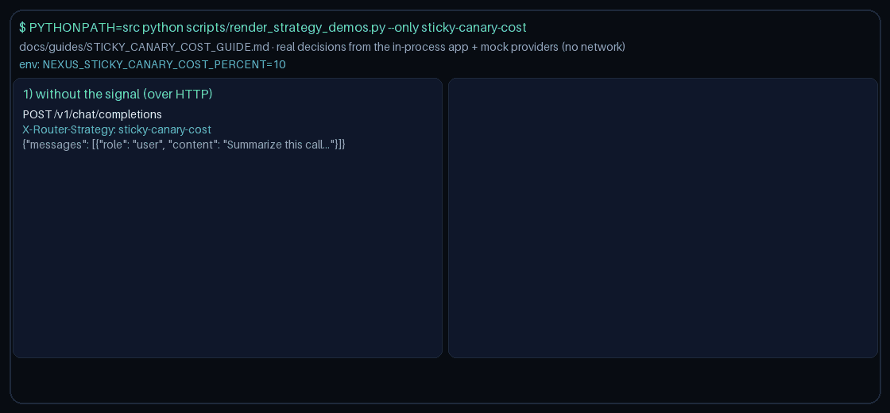

# Sticky-Canary-Cost Routing Guide



Use the `sticky-canary-cost` strategy when tenants need sticky model affinity
with a small canary slice that blends toward cheaper healthy models.

## When to use it

- GPT-6 Astra / Claude Opus 5.5 / Gemini 4 Argon / Kimi K3.1 Pro traffic needs
  per-tenant stickiness for billing, quotas, and prompt-cache warmth.
- Operators also want a controlled cost canary
  (`NEXUS_STICKY_CANARY_COST_PERCENT`, default `10`) that samples cheaper SKUs
  without abandoning sticky affinity for the majority of requests.
- Distinct from `sticky-tenant-hash` (no cost canary) and `canary-cost-blend`
  (no tenant stickiness).

## How it works

1. Resolve a tenant sticky key from `metadata.tenant_id` (then `user_id` /
   `sticky_key` / `session_id` fallbacks).
2. Consistent-hash the sticky key onto a domain-eligible primary model.
3. Off-slice traffic sticks to that primary with healthy ring failover.
4. On the deterministic `request_id` explore slice, blend toward the cheapest
   healthy model that is strictly cheaper than the sticky primary. If none
   exists, keep the sticky primary.

## Quick start

```bash
export NEXUS_DEFAULT_STRATEGY=sticky-canary-cost
export NEXUS_STICKY_CANARY_COST_PERCENT=10
```

Or per request:

```http
X-Router-Strategy: sticky-canary-cost
```

Optional tenant metadata:

```json
{ "metadata": { "tenant_id": "acme" } }
```

> **HTTP note:** strategies read `RouterRequest.metadata`. `POST /v1/chat/completions`,
> `/v1/responses`, and `/v1/messages` do not forward request-body `metadata` to routing
> yet, so over HTTP this strategy takes its no-signal path. Set `metadata` on
> `RouterRequest` when embedding `NexusRouter`, as the demo does
> (`scripts/render_strategy_demos.py`).

## Tuning notes

- Lower the percent (for example `5`) when sticky affinity should dominate.
- Raise the percent (for example `25`) when you want faster cost sampling.
- Pair with `canary-cost-blend` for pure cost exploration without stickiness,
  or `budget-aware` for hard per-request ceilings.

## Suggested repo metadata

- **Description:** Multi-provider LLM router with pluggable strategies, safety
  guardrails, and GPT-6 Astra / Claude Opus 5.5 / Gemini 4 Argon / Kimi K3.1 Pro catalog.
- **Topics:** `llm-router`, `litellm`, `openai`, `anthropic`, `gemini`, `routing`, `python`
