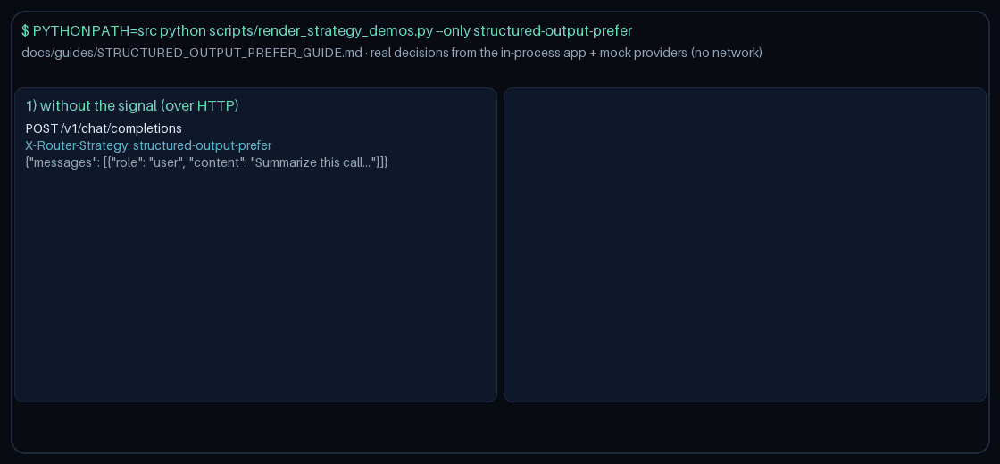

# Structured-Output-Prefer Routing Guide

Use `structured-output-prefer` to bias selection toward models that advertise
JSON / structured-output support when a request declares
`metadata.requires_json` or `metadata.structured_output`, for GPT-6 /
Claude Opus 5.5 / Gemini 4 / Kimi K3.1.



## When to use it

- Gateways that mirror LiteLLM / OpenRouter / Portkey structured-output
  routing and want JSON-capable models preferred for schema-constrained
  responses.
- Workloads that set `requires_json` / `structured_output` upstream and still
  want quality-first routing when those flags are absent.
- Fleets that maintain a per-request `metadata.structured_models` allowlist
  or `metadata.model_capabilities` override for models whose JSON support is
  not yet reflected in the built-in map.

## How it works

1. Read `metadata.requires_json` or `metadata.structured_output`. Truthy
   values are `true` / `1` / `yes` / `on`, or any other non-empty non-falsy
   token.
2. Filter domain-eligible candidates through provider circuit health
   (emergency-retain the full eligible pool when every circuit is open).
3. When structured output is requested, resolve capability from
   `metadata.structured_models`, then `metadata.model_capabilities` /
   the built-in known-model map (`json`, `structured`, or `json_mode`).
   When neither is present for a model, treat names containing `gpt-5`,
   `gpt-6`, `claude`, `gemini`, or `kimi` as structured-capable.
4. Rank by `(supports_structured desc, quality desc, cost asc)`.
5. When the structured-output signal is absent, route quality-first among
   healthy domain-eligible candidates.

## Quick start

```bash
export NEXUS_DEFAULT_STRATEGY=structured-output-prefer
```

Or select it per request:

```http
X-Router-Strategy: structured-output-prefer
```

```json
{
  "metadata": {
    "requires_json": true,
    "structured_models": ["kimi-k3.1-pro"],
    "model_capabilities": {
      "kimi-k3.1-pro": "json"
    }
  }
}
```

No additional `NEXUS_*` environment variables are required — selection is
driven entirely by request metadata.

> **HTTP note:** strategies read `RouterRequest.metadata`. `POST /v1/chat/completions`,
> `/v1/responses`, and `/v1/messages` do not forward request-body `metadata` to routing
> yet, so over HTTP this strategy takes its no-signal path. Set `metadata` on
> `RouterRequest` when embedding `NexusRouter`, as the demo does
> (`scripts/render_strategy_demos.py`).
