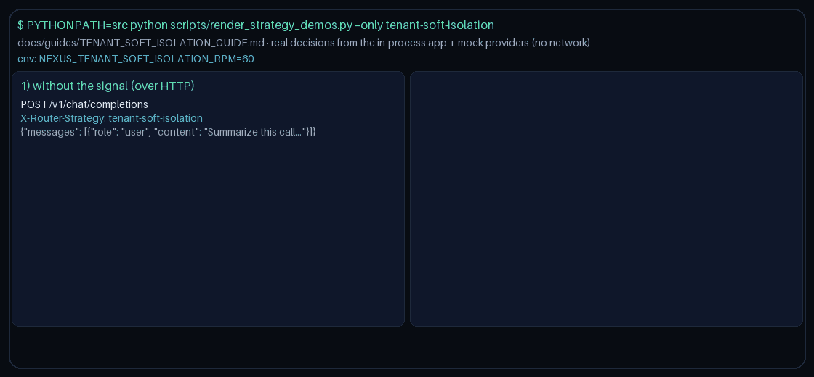

# Tenant-Soft-Isolation Routing Guide

Use `tenant-soft-isolation` to soft-isolate noisy tenants onto
lower-cost capacity instead of frontier models for GPT-6 Astra / Claude
Opus 5.5 / Gemini 4 Argon / Kimi K3.1 Pro, without ever rejecting a request.



## When to use it

- Multi-tenant gateways that want fair-use protection (Portkey/Helicone
  style) so one noisy tenant cannot monopolize frontier-quality routing.
- Fleets that prefer graceful demotion over hard request rejection when a
  tenant bursts past a soft rate.
- Deployments that already compute a tenant's current request rate
  upstream (in an API gateway or rate limiter) and can attach it to the
  request as metadata.

## How it works

1. Read the tenant's reported request rate directly from the request:
   `metadata.tenant_rpm`, falling back to `metadata.tenant_request_rate` as
   an alias. A request that omits both keys, or supplies a non-numeric
   value, is treated as `0` (no reported load).
2. While the reported rate stays at or below
   `NEXUS_TENANT_SOFT_ISOLATION_RPM` (default `60`), route quality-first
   among healthy domain-eligible candidates.
3. Once the reported rate exceeds the soft ceiling, route to the
   lowest-cost healthy domain-compatible model — spare capacity — instead
   of rejecting the request.
4. Provider circuit health is always respected. A tenant identifier
   (resolved from `metadata.tenant_id`, then `metadata.user_id`,
   `metadata.sticky_key`, the top-level `user_id`, and finally
   `session_id`) is included in the rationale for observability, but the
   routing decision itself depends only on the reported rate in the
   current request.

## Quick start

```bash
export NEXUS_DEFAULT_STRATEGY=tenant-soft-isolation
export NEXUS_TENANT_SOFT_ISOLATION_RPM=60
```

Or select it per request:

```http
X-Router-Strategy: tenant-soft-isolation
```

```json
{
  "metadata": {
    "tenant_id": "acme-corp",
    "tenant_rpm": 75
  }
}
```

A tenant reporting `75` requests-per-minute against the default ceiling of
`60` is soft-isolated to the lowest-cost healthy model for this request.

> **HTTP note:** strategies read `RouterRequest.metadata`. `POST /v1/chat/completions`,
> `/v1/responses`, and `/v1/messages` do not forward request-body `metadata` to routing
> yet, so over HTTP this strategy takes its no-signal path. Set `metadata` on
> `RouterRequest` when embedding `NexusRouter`, as the demo does
> (`scripts/render_strategy_demos.py`).
