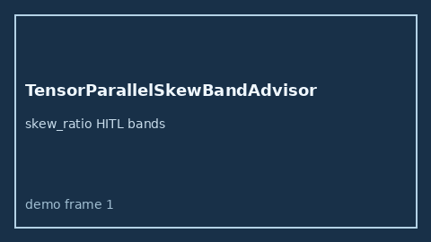

# TensorParallelSkewBandAdvisor Guide



Offline HITL `skew_ratio` bands.
Gap vs vLLM/SGLang/TGI tensor-parallel skew monitors. Distinct from `DisaggPrefillDecodeSkewBandAdvisor` / `TokenizerVocabSkewBandAdvisor`.

Stack: **GPT-5.5 / Claude Sonnet 4.6 / Gemini 3.x / Kimi K2**.

## Usage

```python
from safety.tensor_parallel_skew_band import TensorParallelSkewBandAdvisor

advice = TensorParallelSkewBandAdvisor().advise(request_id="r1", skew_ratio=0.4)
print(advice.band)
```

## Safety

Advisory only. No network I/O.
