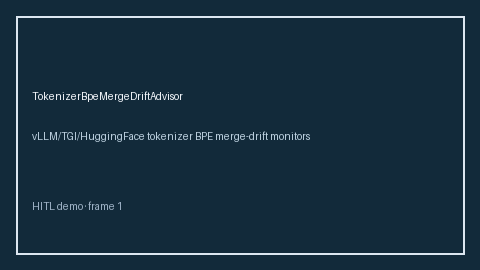

# TokenizerBpeMergeDriftAdvisor Guide



Offline advisor. Never network I/O. Gap vs vLLM/TGI/HuggingFace tokenizer BPE merge-drift monitors.

Optional polish via **GPT-5.5 / Claude Sonnet 4.6 / Gemini 3.x / Kimi K2**.

Distinct from `TokenizerVocabularyDriftAdvisor` / `TokenizerMismatchAdvisor`.

## Usage

```python
from safety.tokenizer_bpe_merge_drift import TokenizerBpeMergeDriftAdvisor

advice = TokenizerBpeMergeDriftAdvisor().advise(request_id="r1", bpe_merge_drift_score=0.0)
print(advice.band)
```

## Safety

Advisory bands only. Humans decide.
