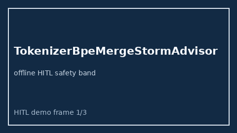

# TokenizerBpeMergeStormAdvisor Guide



Offline HITL advisor for `bpe_merge_storm_rate` bands.
Gap vs vLLM/SGLang/TGI tokenizer BPE merge-storm monitors. Distinct from `TokenizerBpeMergeDriftAdvisor` / `PrefixCacheHitFloorAdvisor`.

Optional polish via **GPT-5.5 / Claude Sonnet 4.6 / Gemini 3.x / Kimi K2**.

## Usage

```python
from safety.tokenizer_bpe_merge_storm import TokenizerBpeMergeStormAdvisor

advice = TokenizerBpeMergeStormAdvisor().advise(request_id="r1", bpe_merge_storm_rate=0.25)
print(advice.band)
```

## Safety

Advisory only. No network I/O. Humans decide.
