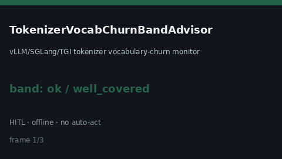

# TokenizerVocabChurnBandAdvisor Guide



Offline `churn_ratio` band advisor.
Gap vs vLLM/SGLang/TGI tokenizer vocabulary-churn monitors. Distinct from `TokenizerVocabSkewBandAdvisor` / `TokenizerBpeMergeDriftAdvisor`.

Stack: **GPT-6.1 / Claude Sonnet 5.5 / Gemini 3.x / Kimi K3**.

## Usage

```python
from safety.tokenizer_vocab_churn_band import TokenizerVocabChurnBandAdvisor

advice = TokenizerVocabChurnBandAdvisor().advise(
    request_id="req-1",
    churn_ratio=0.35,
    soft_limit=0.2,
    hard_limit=0.5,
)
print(advice.band)
```

## Safety

Advisory only. No network I/O. Never auto-acts. Humans decide.
