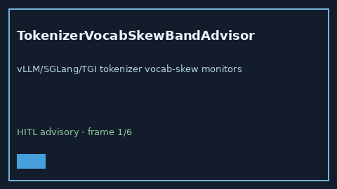

# TokenizerVocabSkewBandAdvisor Guide



Offline HITL `vocab_skew_ratio` bands.
Gap vs vLLM/SGLang/TGI tokenizer vocab-skew monitors. Distinct from `TokenizerVocabularyDriftAdvisor` / `RopeScaleMismatchBandAdvisor`.

Stack: **GPT-5.5 / Claude Sonnet 4.6 / Gemini 3.x / Kimi K2**.

## Usage

```python
from safety.tokenizer_vocab_skew_band import TokenizerVocabSkewBandAdvisor

advice = TokenizerVocabSkewBandAdvisor().advise(request_id="r1", vocab_skew_ratio=0.3)
print(advice.band)
```

## Safety

Advisory only. No network I/O. Never auto-acts. Humans decide.
