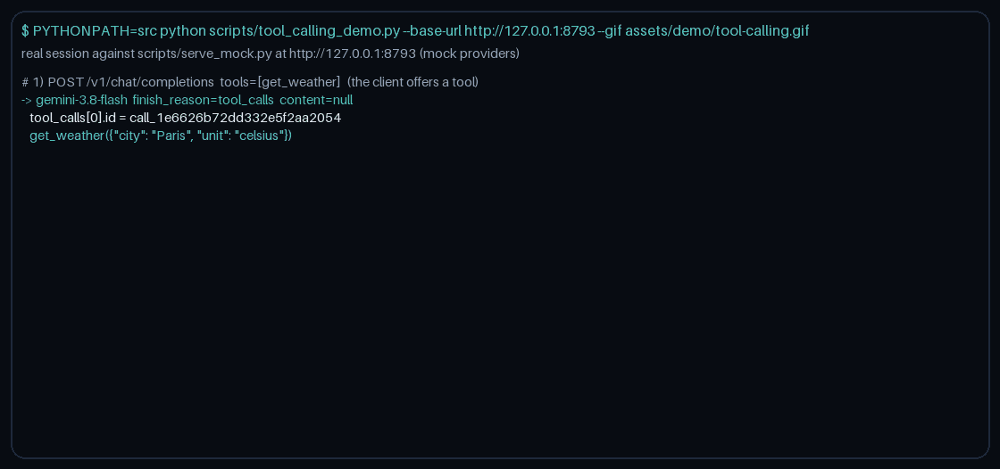

# Tool Calling Guide (`tools` on `POST /v1/chat/completions`)



*Recorded from a real run of [`scripts/tool_calling_demo.py`](../../scripts/tool_calling_demo.py)
against [`scripts/serve_mock.py`](../../scripts/serve_mock.py) (mock providers, no API keys;
see [How the demo was recorded](#how-the-demo-was-recorded)).*

Nexus routes **OpenAI-style tool (function) calling**. Send the OpenAI Chat
Completions `tools`, `tool_choice`, and `parallel_tool_calls` fields, get
`message.tool_calls` back, run the function in your application, and send the
result as a `role: "tool"` message. The same request works whichever provider
the routing strategy picks: nexus translates it to the OpenAI Responses API,
Anthropic tool use, Gemini function calling, or Kimi's OpenAI-compatible API, and
translates the model's calls back. Tool requests only go to models whose
capability data lists `tools`.

**Nexus never executes a tool.** It forwards the model's calls to your client and
your client's results to the model; tool arguments and results never reach the
audit log or the logs.

## Contents

- [Why](#why)
- [Prerequisites](#prerequisites)
- [Quickstart](#quickstart)
- [API reference](#api-reference)
- [Streaming](#streaming)
- [Errors](#errors)
- [How each provider is translated](#how-each-provider-is-translated)
- [Capability-aware routing](#capability-aware-routing)
- [How tool calling interacts with other nexus features](#how-tool-calling-interacts-with-other-nexus-features)
- [Configuration](#configuration)
- [Safety](#safety)
- [Limitations and roadmap](#limitations-and-roadmap)
- [Troubleshooting](#troubleshooting)
- [FAQ](#faq)
- [How the demo was recorded](#how-the-demo-was-recorded)
- [Tests](#tests)

## Why

- **Agent frameworks call tools.** The OpenAI Agents SDK, LangGraph, and most
  agent loops send `tools` and expect `tool_calls`; a gateway that only passes
  text cannot sit in front of them.
- **The current OpenAI models need the Responses API for tools.** GPT-6.2 Astra
  and GPT-6.2 Sol accept tool calling only through the Responses API, while most
  clients still speak Chat Completions. Nexus bridges the two.
- **Every provider spells it differently.** Anthropic wants `input_schema` tools,
  `tool_use` / `tool_result` blocks, and `tool_choice: {"type": "any"}`; Gemini
  wants `functionDeclarations`, `functionCallingConfig`, `functionResponse`
  parts, and thought signatures replayed on the next turn.

Popular gateways already normalize this; nexus did not:

| Capability | [LiteLLM](https://docs.litellm.ai/docs/completion/function_call) | [Portkey AI Gateway](https://github.com/Portkey-AI/gateway) | [OpenRouter](https://openrouter.ai/docs/features/tool-calling) | nexus before | nexus now |
| --- | --- | --- | --- | --- | --- |
| One OpenAI-shaped tool API across providers | yes | yes ([Anthropic](https://github.com/Portkey-AI/gateway/blob/main/src/providers/anthropic/chatComplete.ts), [Gemini](https://github.com/Portkey-AI/gateway/blob/main/src/providers/google/chatComplete.ts) transforms) | yes | no (text only) | yes |
| Knows which models can call tools | `litellm.supports_function_calling(model)` | - | routes tool requests only to providers that support tools | capability flags existed but nothing enforced them | capability-catalog gate before dispatch; 400 `tool_calling_unsupported` when no routed model qualifies |
| Gemini thought signatures across turns | embedded in the tool-call id (`__thought__`, [source](https://github.com/BerriAI/litellm/blob/main/litellm/litellm_core_utils/prompt_templates/factory.py)) | `function.thought_signature` field | - | - | embedded in the tool-call id with the same `__thought__` separator |
| Streaming tool calls | native | native | native | - | OpenAI `delta.tool_calls` chunks from a non-streamed provider call |
| Executes tools for you | no | no | its Agent SDK runs client tools | - | no, never |

What nexus adds on top: the routing strategy still chooses the model (with
fallbacks, budgets, circuit breakers, and the audit trail), and the tool gate
is part of that decision rather than a client-side check.

## Prerequisites

- Python 3.11+ and the repository installed (`pip install -e '.[dev]'`), see
  [QUICKSTART.md](../../QUICKSTART.md).
- For a keyless trial: [`scripts/serve_mock.py`](../../scripts/serve_mock.py),
  which routes every provider to the deterministic mock adapter (it emulates
  tool calls, see [Mock provider](#mock-provider)).
- For real providers: at least one of `OPENAI_API_KEY`, `ANTHROPIC_API_KEY`,
  `GOOGLE_API_KEY`, `MOONSHOT_API_KEY` (see [CONFIGURATION.md](../../CONFIGURATION.md)).
- Optional: the official OpenAI Python SDK (`pip install openai`) for the SDK
  example. No new nexus setting is needed.

## Quickstart

Start nexus with mock providers:

```bash
PYTHONPATH=src python scripts/serve_mock.py --port 8000
```

### curl: offer a tool, get a tool call

```bash
curl -s http://127.0.0.1:8000/v1/chat/completions \
  -H 'Authorization: Bearer sk-demo-local' -H 'Content-Type: application/json' \
  -d '{
    "model": "gpt-6.2-sol",
    "messages": [{"role": "user", "content": "What'"'"'s the weather in Paris right now?"}],
    "tools": [{
      "type": "function",
      "function": {
        "name": "get_weather",
        "description": "Current weather for a city",
        "parameters": {
          "type": "object",
          "properties": {
            "city": {"type": "string", "description": "City name", "examples": ["Paris"]},
            "unit": {"type": "string", "enum": ["celsius", "fahrenheit"]}
          },
          "required": ["city", "unit"]
        }
      }
    }]
  }'
```

Real output (mock providers; `router.latency_ms` trimmed):

```json
{
  "id": "chatcmpl-4881c070661844efa6267fded6462fde",
  "object": "chat.completion",
  "created": 1795768332,
  "model": "gemini-3.8-flash",
  "choices": [
    {
      "index": 0,
      "message": {
        "role": "assistant",
        "content": null,
        "tool_calls": [
          {
            "id": "call_1e6626b72dd332e5f2aa2054",
            "type": "function",
            "function": {
              "name": "get_weather",
              "arguments": "{\"city\": \"Paris\", \"unit\": \"celsius\"}"
            }
          }
        ]
      },
      "finish_reason": "tool_calls"
    }
  ],
  "usage": {"prompt_tokens": 9, "completion_tokens": 16, "total_tokens": 25},
  "router": {
    "content": "",
    "model_used": "gemini-3.8-flash",
    "routing_strategy": "rule-based",
    "input_tokens": 9,
    "output_tokens": 16,
    "cost_usd": 2.5e-05,
    "rationale": "simple realtime prompt favors low latency",
    "request_id": "613f349ef05b4796a79ec5d15bf6e640",
    "finish_reason": "tool_calls"
  }
}
```

`model` is a hint: the routing strategy makes the final choice (here
`rule-based` sent a short realtime prompt to Gemini 3.8 Flash) and
`router.model_used` / `router.rationale` say which model answered and why.

### The OpenAI Python SDK: the full loop

```python
import json

from openai import OpenAI

client = OpenAI(base_url="http://127.0.0.1:8000/v1", api_key="sk-demo-local")
tools = [{
    "type": "function",
    "function": {
        "name": "get_weather",
        "description": "Current weather for a city",
        "parameters": {
            "type": "object",
            "properties": {
                "city": {"type": "string", "examples": ["Paris"]},
                "unit": {"type": "string", "enum": ["celsius", "fahrenheit"]},
            },
            "required": ["city", "unit"],
        },
    },
}]


def get_weather(city: str, unit: str) -> dict:
    """Your own function: nexus never runs it."""
    return {"city": city, "temp": 18, "unit": unit, "sky": "clear"}


messages = [{"role": "user", "content": "What's the weather in Paris right now?"}]
while True:
    response = client.chat.completions.create(model="gpt-6.2-sol", messages=messages, tools=tools)
    message = response.choices[0].message
    if not message.tool_calls:
        print(message.content)
        break
    messages.append(message)  # the assistant turn with its tool_calls
    for call in message.tool_calls:
        result = get_weather(**json.loads(call.function.arguments))
        messages.append({"role": "tool", "tool_call_id": call.id, "content": json.dumps(result)})
```

Output against the mock server (a real model writes a natural-language answer):

```text
[gemini-3.8-flash] answer from tool results: get_weather returned {"city": "Paris", "temp": 18, "unit": "celsius", "sky": "clear"}
```

`client.chat.completions.stream(...)` works too: the SDK's stream accumulator
rebuilds the same `tool_calls` from the chunks (see [Streaming](#streaming)).

## API reference

Tool calling uses the standard OpenAI Chat Completions fields on
`POST /v1/chat/completions`. Every other request field, header
(`X-Router-Strategy`, `X-Tenant-Id`, `Idempotency-Key`), and response field
works as for text-only requests (see the [README](../../README.md#core-gateway)).

### Request fields

| Field | Type | Default | Rules |
| --- | --- | --- | --- |
| `tools` | array of `{"type": "function", "function": {...}}` | none | At most **128** tools; an empty list counts as no tools. Only `function` tools. |
| `tools[].function.name` | string | required | Must match `^[a-zA-Z0-9_-]{1,64}$` and be unique across `tools`. |
| `tools[].function.description` | string | none | Forwarded to every provider. |
| `tools[].function.parameters` | JSON Schema object | `{"type": "object", "properties": {}}` | Must have `"type": "object"` (OpenAI, Anthropic, and Gemini all require an object schema). |
| `tools[].function.strict` | boolean | none | Forwarded to OpenAI (nexus sends `strict: false` unless you set `true`, because the Responses API defaults to `true`) and Kimi; Anthropic and Gemini do not receive it. |
| `tool_choice` | `"none"`, `"auto"`, `"required"`, or `{"type": "function", "function": {"name": "..."}}` | provider default (`auto` when tools are offered) | A named choice must name a declared tool; `"required"` needs at least one tool. `"none"` / `"auto"` without tools are accepted and have no effect. |
| `parallel_tool_calls` | boolean | provider default | `false` asks for at most one call per turn (see [How each provider is translated](#how-each-provider-is-translated)). |
| `functions`, `function_call` | - | - | Deprecated OpenAI parameters: rejected with 400 `unsupported_parameter` instead of being silently ignored. Send `tools` / `tool_choice`. |

### Message fields

| Message | Fields | Rules |
| --- | --- | --- |
| assistant turn that called tools | `role: "assistant"`, `tool_calls: [{"id", "type": "function", "function": {"name", "arguments"}}]`, `content` | `content` may be `null`, omitted, empty, or text. Ids must be non-empty and unique within the message, names must match the tool-name pattern, and `arguments` must be a JSON-encoded **object**. `tool_calls: []` counts as no calls. |
| tool result | `role: "tool"`, `tool_call_id`, `content` | `tool_call_id` is required and must answer a call of the nearest preceding assistant `tool_calls` message (with only `tool` messages in between). `content` is a string: JSON or plain text. |

Pairing rules, checked before routing so the outcome never depends on which
provider the strategy picks (Anthropic and Gemini reject unpaired calls):

- every call of an assistant `tool_calls` message is answered exactly once
  before the next non-`tool` message and before the end of `messages`;
- only assistant messages carry `tool_calls`, and only `tool` messages carry
  `tool_call_id`.

### Response fields

| Field | Value |
| --- | --- |
| `choices[0].message.tool_calls` | The model's calls (`id`, `type: "function"`, `function.name`, `function.arguments` as a JSON string). Omitted when the model called no tool, so text answers keep their exact pre-tool-calling shape. |
| `choices[0].message.content` | `null` when the model only called tools; text that a model writes next to its calls (for example Claude's "Let me check that") is kept. |
| `choices[0].finish_reason` | `"tool_calls"` when the model stopped to call tools, `"length"` when it hit `max_tokens` (even mid-call: the arguments may be cut off), otherwise `"stop"`. |
| `router.finish_reason`, `router.content` | Same finish reason; `router.content` is `""` for a tools-only answer. The `router` block never repeats tool arguments. |

Echo each `id` back exactly as received in your `tool` messages. Ids are the
provider's own (`call_...` from OpenAI, `toolu_...` from Anthropic, Kimi's ids)
or, for Gemini and the mock provider, stable `call_<24 hex>` ids that nexus
derives from the request. Gemini ids may end with `__thought__<signature>`
(see [Gemini](#gemini-gemini-4-neon-carbon-hydrogen-argon-gemini-38-flash)).

## Streaming

With `"stream": true`, a request that offers tools or replays tool calls is
answered from **one non-streaming provider call**: nexus waits for the complete
answer, then sends it as OpenAI `chat.completion.chunk` frames:

1. a role chunk, `{"role": "assistant", "content": ...}` (`null` when the model
   only called tools, otherwise the whole text);
2. one chunk per call with `delta.tool_calls[0]` carrying its `index`, `id`,
   `type`, `function.name`, and the **complete** `function.arguments`;
3. a finish chunk with `finish_reason` (`"tool_calls"`, `"stop"`, or `"length"`);
4. `data: [DONE]`.

Real output of the quickstart request with `"stream": true` (mock providers):

```text
data: {"id": "chatcmpl-c9db2e35ff904bb1a99e2c726d22852f", "object": "chat.completion.chunk", "created": 1795806779, "model": "gemini-3.8-flash", "choices": [{"index": 0, "delta": {"role": "assistant", "content": null}, "finish_reason": null}]}

data: {"id": "chatcmpl-c9db2e35ff904bb1a99e2c726d22852f", "object": "chat.completion.chunk", "created": 1795806779, "model": "gemini-3.8-flash", "choices": [{"index": 0, "delta": {"tool_calls": [{"index": 0, "id": "call_1e6626b72dd332e5f2aa2054", "type": "function", "function": {"name": "get_weather", "arguments": "{\"city\": \"Paris\", \"unit\": \"celsius\"}"}}]}, "finish_reason": null}]}

data: {"id": "chatcmpl-c9db2e35ff904bb1a99e2c726d22852f", "object": "chat.completion.chunk", "created": 1795806779, "model": "gemini-3.8-flash", "choices": [{"index": 0, "delta": {}, "finish_reason": "tool_calls"}]}

data: [DONE]
```

Why not token-by-token: provider tool-call streams differ widely (OpenAI
Responses `function_call_arguments.delta` events, Anthropic `input_json_delta`,
Gemini whole `functionCall` parts), and a call is only useful to the client
once its arguments are complete. Clients that accumulate argument fragments by
`index` (the OpenAI SDK's `chat.completions.stream`, LangChain, the Agents SDK)
read the single fragment unchanged. Consequences:

- the first byte arrives when the model has finished (no lower time-to-first-token);
- spend, audit, fallbacks, and budgets work exactly as for non-streaming requests;
- a routing failure is an **HTTP error before any frame** (for example 400
  `tool_calling_unsupported` or 503), never an `error` event inside a 200 stream
  as on text-only streams.

Text-only streams (no `tools`, no tool messages) are unchanged and still stream
provider chunks as they arrive.

## Errors

Every tool-calling request error is an OpenAI-style 400 with
`"type": "invalid_request_error"`, a `param` path, and a `code`. Messages name
indices, ids, and function names, never tool arguments or results.

| `code` | `param` | When |
| --- | --- | --- |
| `invalid_value` | `tools[i].function.name` | The name does not match `^[a-zA-Z0-9_-]{1,64}$`. |
| `invalid_value` | `tools[i].function.parameters` | The schema's `type` is not `"object"`. |
| `invalid_value` | `tools[i].type` | A tool type other than `"function"`. |
| `invalid_value` | `tools` | More than 128 tools, or duplicate function names. |
| `invalid_value` | `tool_choice` | An unknown value, a named function that `tools` does not declare, or `"required"` without tools. |
| `invalid_value` | `parallel_tool_calls` | Not a JSON boolean. |
| `unsupported_parameter` | `functions` / `function_call` | The deprecated function-calling parameters. |
| `missing_required_parameter` | `messages[i].tool_call_id` | A `tool` message without `tool_call_id`. |
| `invalid_value` | `messages[i].tool_call_id` | A result that answers no call of the preceding assistant message, answers one twice, or a `tool_call_id` on a non-`tool` message. |
| `invalid_value` | `messages[i].tool_calls` | Calls left unanswered, or `tool_calls` on a non-assistant message. |
| `invalid_value` | `messages[i].tool_calls[j].id`, `.function.name`, `.function.arguments` | An empty or duplicate id, an invalid name, or arguments that are not a JSON-encoded object. |
| `tool_calling_unsupported` | `null` | No model in the routing decision supports tool calling (see [Capability-aware routing](#capability-aware-routing)). |

Other failures keep the route's existing behaviour: 429 rate limits, 402 budget
refusals, 409 `Idempotency-Key` in use, and 503 when every provider attempt
failed (FastAPI `{"detail": ...}` bodies), plus FastAPI 422s for invalid
non-tool fields.

Real responses (mock providers):

```json
{"error": {"message": "Invalid 'messages[1].tool_call_id': messages with role 'tool' must answer a tool call of the preceding assistant message; no such call has id 'call_x'.", "type": "invalid_request_error", "param": "messages[1].tool_call_id", "code": "invalid_value"}}
```

```json
{"error": {"message": "Invalid 'messages[1].tool_calls': an assistant message with 'tool_calls' must be followed by 'tool' messages answering each call; no result for: call_1e6626b72dd332e5f2aa2054.", "type": "invalid_request_error", "param": "messages[1].tool_calls", "code": "invalid_value"}}
```

```json
{"error": {"message": "Invalid value for 'tool_choice': function 'get_time' is not declared in 'tools'.", "type": "invalid_request_error", "param": "tool_choice", "code": "invalid_value"}}
```

```json
{"error": {"message": "Unsupported parameter: 'functions' is deprecated and not supported by nexus; send 'tools' and 'tool_choice' instead.", "type": "invalid_request_error", "param": "functions", "code": "unsupported_parameter"}}
```

```json
{"error": {"message": "no model in the routing decision supports tool calling: rule-based chose gemini-3.8-flash, claude-opus-5-5, gpt-6.2-astra, gemini-4-argon, and the capability catalog lists 'tools' for none of them", "type": "invalid_request_error", "param": null, "code": "tool_calling_unsupported"}}
```

## How each provider is translated

Clients always speak the OpenAI Chat Completions shape; each adapter translates
the request and the answer. Nexus never executes a tool in any adapter.

| | OpenAI | Anthropic | Gemini | Kimi (Moonshot) | Mock |
| --- | --- | --- | --- | --- | --- |
| Endpoint for tool requests | `POST /v1/responses` | `POST /v1/messages` | `generateContent` | `POST /v1/chat/completions` | in memory |
| `tools` | `{"type": "function", name, description, parameters, strict}` | `{name, description, input_schema}` | `functionDeclarations` with `parametersJsonSchema` | unchanged | used to build arguments |
| `tool_choice: "auto"` / `"required"` / `"none"` | unchanged | `auto` / `any` / `none` | `AUTO` / `ANY` / `NONE` | unchanged | emulated |
| Named `tool_choice` | `{"type": "function", "name"}` | `{"type": "tool", "name"}` | `ANY` + `allowedFunctionNames` | unchanged | calls that function |
| `parallel_tool_calls: false` | unchanged | `disable_parallel_tool_use: true` | nexus keeps the first call | unchanged | always one call |
| Assistant `tool_calls` | `function_call` items | `tool_use` blocks | `functionCall` parts | unchanged | read for results |
| `tool` results | `function_call_output` items | `tool_result` blocks in a `user` turn | `functionResponse` parts in a `user` turn | unchanged | quoted in the answer |
| Stop reason for calls | `function_call` output items | `stop_reason: "tool_use"` | `functionCall` parts | `finish_reason: "tool_calls"` | - |

Requests without tools and without tool messages use exactly the payloads they
used before tool calling existed.

### OpenAI (GPT-6.2 Astra, GPT-6.2 Sol, GPT-6.1 Terra, GPT-6 Luna)

GPT-6.2 Astra and GPT-6.2 Sol accept tool calling only through the Responses
API, and every GPT-6.x model supports it, so the OpenAI adapter sends every
request that offers tools or replays tool calls to `POST /v1/responses`:

- `system` messages become `developer` input messages in place, user and
  assistant text become `message` items, assistant `tool_calls` become
  `function_call` items (`call_id`, `name`, `arguments`), and `tool` results
  become `function_call_output` items paired by `call_id`;
- `store` is `false`: nexus is stateless and resends the conversation every
  turn, so nothing is kept at OpenAI and `previous_response_id` is not used;
- `max_output_tokens` is `max(max_tokens, 16)` (the Responses API minimum);
- the answer's `function_call` items become `tool_calls` (their `call_id` is the
  client-visible id), `output_text` / `refusal` parts become `content`, and
  `incomplete_details.reason: "max_output_tokens"` becomes `finish_reason: "length"`.

Tool-free requests stay on `POST /v1/chat/completions` unchanged.

### Anthropic (Claude Opus 5.5, Claude Sonnet 5.5, Claude Haiku 5.5)

- Tools become `{name, description, input_schema}`; `tool_choice` maps
  `auto` → `{"type": "auto"}`, `required` → `{"type": "any"}`, `none` →
  `{"type": "none"}`, and a named choice → `{"type": "tool", "name": ...}`;
  `parallel_tool_calls: false` adds `disable_parallel_tool_use: true`.
- Assistant `tool_calls` become `tool_use` blocks (after any text block) with
  `input` parsed from `arguments`; `tool` messages become `tool_result` blocks
  (`tool_use_id`, `content`) in a `user` turn, and **consecutive results share
  one `user` turn**, as Anthropic requires for parallel calls.
- Anthropic rejects `tool_use` blocks unless `tools` are defined, so a
  conversation that replays tool calls without offering tools sends minimal
  definitions of the called functions with `tool_choice: {"type": "none"}`.
- `tool_use` blocks in the answer become `tool_calls` (the `toolu_...` id is
  kept), `stop_reason: "tool_use"` becomes `"tool_calls"`, and `max_tokens`
  becomes `"length"`.

### Gemini (Gemini 4 Neon, Carbon, Hydrogen, Argon, Gemini 3.8 Flash)

- Tools become `tools: [{"functionDeclarations": [...]}]` with the schema in
  `parametersJsonSchema` (full JSON Schema, so `examples`, `enum`, and nested
  objects pass through); `tool_choice` becomes
  `toolConfig.functionCallingConfig.mode` (`AUTO` / `ANY` / `NONE`, and `ANY`
  with `allowedFunctionNames: [name]` for a named choice).
- Gemini has no switch for parallel calls, so with `parallel_tool_calls: false`
  nexus returns only the first `functionCall` of the answer.
- `functionCall` parts become `tool_calls`, keeping Gemini's call `id` when it
  sends one. Otherwise nexus derives a stable `call_<24 hex>` id from the
  request digest, the call's position, name, and arguments: the same request
  gets the same id, and the next turn (a different request) gets new ones.
- **Thought signatures.** Gemini 3 and later attach a `thoughtSignature` to
  function calls and reject a replayed call without it. OpenAI clients only echo
  `id`, `type`, and `function`, so nexus embeds the signature in the id as
  `<id>__thought__<url-safe base64>`, the same separator LiteLLM uses, and
  restores it on the next turn. When none of a replayed assistant turn's calls
  carries a signature (for example calls Claude made earlier in the
  conversation), its first call gets Gemini's documented
  `skip_thought_signature_validator` placeholder.
- `tool` results become `functionResponse` parts in a `user` turn, named after
  the call they answer (looked up by `tool_call_id`); a JSON-object result is
  sent as `response`, any other text as `{"output": "<text>"}`. Consecutive
  results share one turn.

### Kimi (Kimi K3.1 Pro, Kimi K3.1 Pro Highspeed)

Kimi's API is OpenAI-compatible: `tools`, `tool_choice`,
`parallel_tool_calls`, assistant `tool_calls`, `tool` results, and the
answer's `tool_calls` / `finish_reason` pass through unchanged. Values Kimi
does not accept are rejected by Kimi and handled like any provider rejection.

### Mock provider

[`src/adapters/mock.py`](../../src/adapters/mock.py) emulates tool calling
deterministically, so tests, demos, and `scripts/serve_mock.py` run the whole
round trip offline:

- when tools are offered and `tool_choice` is not `"none"`, it calls the
  function a named `tool_choice` forces, otherwise the first declared tool;
- arguments are built from the JSON Schema: every `required` property (every
  property when none is required) gets its first `const`, `enum`, `default`, or
  `examples` value, else a placeholder for its type (`"mock-<name>"`, the
  `minimum` or 1, `true`, `[]`, or a nested object);
- with `tool_choice` `"auto"` (or omitted), a conversation that ends with tool
  results gets a text answer quoting them
  (`[<model>] answer from tool results: get_weather returned {...}`);
  `"required"` and a named choice keep calling.

### Cross-provider conversations

A conversation can move between providers turn by turn (a fallback, or a
strategy choosing another model). Ids outside `^[A-Za-z0-9_-]{1,64}$`, the
format every provider accepts (a long Gemini id carrying a signature, or an id
with `.` or `:`), are replaced in the OpenAI and Anthropic payloads by a stable
`call_<24 hex>` digest, the same for the call and its result, so pairs stay
matched. Clients always see and echo the original ids.

## Capability-aware routing

A request **uses tools** when it offers `tools` or replays tool calls or tool
results in `messages` (a final turn without `tools` still carries the earlier
calls, so it still needs a tool-capable model). For such requests:

1. The routing strategy (`X-Router-Strategy`, default `rule-based`) chooses a
   model and a fallback chain exactly as for any request.
2. Nexus keeps, in the strategy's order, only the attempts whose capability data
   lists `tools`. It never adds a model the decision did not contain, so
   strategies that restrict providers, regions, or budgets keep their guarantees.
3. Skipped models are named in `router.rationale`.
4. If no attempt qualifies, the request fails with 400 `tool_calling_unsupported`
   **before any provider is called**: no spend, no provider traffic, and a
   `tool_calling_unsupported` warning log with the strategy and model names.

Real rationale with Gemini 3.8 Flash marked as not tool-capable (mock
providers): `rule-based` chose it, nexus skipped it, and the first fallback,
Claude Opus 5.5, answered with `finish_reason: "tool_calls"`:

```text
simple realtime prompt favors low latency; tool calling skipped gemini-3.8-flash (no tools capability)
```

### Where capability data comes from

Every model in the built-in catalog (GPT-6.2 Astra / Sol, GPT-6 Luna, Claude
Opus 5.5, Claude Haiku 5.5, Gemini 4 Neon / Argon, Gemini 3.8 Flash, Kimi K3.1
Pro) lists `tools`; `GET /v1/models` shows the same data in
`nexus.capabilities` (see the [Models API guide](MODELS_API_GUIDE.md)). The
gate reads `NexusRouter.capability_catalog`, a
[`ModelCapabilityCatalog`](CAPABILITY_CATALOG_GUIDE.md) seeded with those
capabilities for every catalog model. When you add your own models to the
catalog, declare their tool support:

```python
router = NexusRouter(settings, adapter_registry, model_catalog=my_catalog)
router.capability_catalog.upsert("my-fine-tuned-model", {"tools", "json", "streaming"})
```

Or pass `capability_catalog=` to `NexusRouter`. Start from the router's own
catalog (or a `seed=` covering every model): a bare `ModelCapabilityCatalog()`
auto-seeds only GPT-6.2 Astra, Claude Opus 5.5, Gemini 3.8 Flash, and Kimi K3.1
Pro, so tool requests would skip every other model. `upsert` changes routing
only; `GET /v1/models` keeps reporting the built-in capability data.

### Preferring tool-capable models

The gate only filters. To rank tool-capable models first (by quality, then
cost), send `X-Router-Strategy: tool-calling-prefer`: it now treats offered
`tools` (or replayed tool calls) as a tool request, in addition to the
`metadata.requires_tools` / `metadata.tools` signals it already read.

## How tool calling interacts with other nexus features

| Feature | Behaviour with tools |
| --- | --- |
| Routing strategies, fallbacks, circuit breakers | Unchanged, restricted to tool-capable attempts ([Capability-aware routing](#capability-aware-routing)). A fallback can continue a conversation another provider started ([Cross-provider conversations](#cross-provider-conversations)). |
| Token estimates, budgets, cost forecasts | The pre-dispatch prompt estimate counts the tool definitions and earlier tool calls, as providers bill them as input tokens, so budget caps see the larger prompt. Requests without tools estimate exactly as before. |
| Response cache | Keys include `tools`, `tool_choice`, `parallel_tool_calls`, assistant `tool_calls`, and `tool_call_id`, so a completion is never replayed for another tool set or another tool result. A cached tool-call answer replays its `tool_calls`. Requests without tools keep their existing keys. |
| `Idempotency-Key` | Replays the stored response, `tool_calls` included; keys stay scoped by endpoint and caller as before. A 400 (including `tool_calling_unsupported`) frees the key for a corrected retry. |
| Request fingerprints | `RequestFingerprintDeduper.fingerprint(..., tools=ToolConfig.canonical())` covers the tool settings; digests of requests without tools are unchanged. |
| Audit log | Records `tool_count` (tools offered) and `tool_call_names` (functions the model called) for tool requests, never arguments or results. Lines of tool-free requests are unchanged. |
| Logs | `routing_response` adds `tools_offered` and `tool_calls` (names) for tool requests. |
| PII scrubbing (`NEXUS_ENABLE_PII_SCRUBBING`) | Scrubs replayed tool-call arguments and tool results leaf by leaf, so JSON stays valid JSON; ids and function names are kept so calls still pair. |
| Streaming | Answered from one non-streaming provider call ([Streaming](#streaming)). |
| `POST /v1/responses`, `POST /v1/messages` | Still text-only: they keep rejecting `tools` / an active `tool_choice` (see [Limitations and roadmap](#limitations-and-roadmap)). |

Real audit line of the quickstart request (mock providers):

```json
{"request_id":"38c37ea6ae5049d794b2a49e872e1cbf","chosen_model":"gemini-3.8-flash","provider":"google","routing_strategy":"rule-based","rationale":"simple realtime prompt favors low latency","latency_ms":0.23070800671121106,"token_cost":0.000025,"input_tokens":9,"output_tokens":16,"state":"RESPONDED","api_key_id":"key_534c5604f303b8a9","tenant_id":null,"domain":"general","tool_count":1,"tool_call_names":["get_weather"]}
```

## Configuration

Tool calling needs no new setting: it is on for every request that sends
`tools`. Related settings ([CONFIGURATION.md](../../CONFIGURATION.md)):

| Setting | Effect on tool calling |
| --- | --- |
| `OPENAI_API_KEY`, `ANTHROPIC_API_KEY`, `GOOGLE_API_KEY`, `MOONSHOT_API_KEY` | Providers the router can use; unconfigured providers fail over as usual. |
| `NEXUS_DEFAULT_STRATEGY` | Strategy used when `X-Router-Strategy` is absent; the tool gate applies to every strategy. |
| `NEXUS_ENABLE_PII_SCRUBBING` | Also scrubs tool arguments and tool results before dispatch. |
| `NEXUS_RESPONSE_CACHE_ENABLED`, `NEXUS_RESPONSE_CACHE_TTL_SECONDS` | Cache tool-call answers like any other answer. |
| `REQUEST_TIMEOUT_SECONDS` | Provider timeout; applies to the single provider call of a streamed tool request too. |

## Safety

- **Nexus never executes tools.** There is no tool registry, no code execution,
  and no call to any tool endpoint: nexus forwards the model's calls to your
  client and your client's results to the model. Your application decides
  whether to run each call.
- **Treat tool calls as untrusted model output.** A prompt-injected document
  or tool result can make a model request a harmful call. Validate arguments
  against your own schema (models can emit arguments that do not match it;
  OpenAI's `strict: true` narrows this), allowlist side-effecting functions, and
  ask a human to confirm destructive actions.
- **Tool results go back to the model as-is** (after optional PII scrubbing).
  Keep secrets and credentials out of them.
- **No arguments or results in logs or the audit trail.** Only tool counts and
  called function names are recorded; tool-calling error messages name indices,
  ids, and function names only.
- **PII scrubbing** (`NEXUS_ENABLE_PII_SCRUBBING=true`) covers replayed
  arguments and tool results, scrubbing JSON leaf by leaf so it stays valid JSON.
  As for text answers, the model's own new calls are returned unscrubbed.
- **Malformed conversations never reach a provider:** tool-call pairing and
  schemas are checked before routing, and requests no tool-capable model can
  serve are refused before dispatch.
- **Tenant isolation is unchanged:** cached and idempotent tool-call answers
  stay in the caller's namespace.

See [SAFETY.md](../../SAFETY.md#tool-calling) for the gateway-wide policy.

## Limitations and roadmap

- **Streaming is not token-by-token** for tool requests: one non-streaming
  provider call, then OpenAI-shaped chunks. *Roadmap:* incremental
  `delta.tool_calls` argument streaming per provider.
- **`/v1/responses` and `/v1/messages` stay text-only**: they still reject
  `tools` and an active `tool_choice`. *Roadmap:* function tools on both, reusing
  the same adapters and routing gate.
- **Function tools only.** Hosted and built-in tools (web search, file search,
  code interpreter, remote MCP, computer use), OpenAI custom (free-form) tools,
  `allowed_tools` choices, and Gemini tool retrieval (`defer_loading`) are not
  supported.
- **OpenAI reasoning items are not carried between turns.** Requests use
  `store: false` without encrypted reasoning items, so GPT-6.x models re-reason
  on each tool turn. *Roadmap:* round-trip `reasoning.encrypted_content`.
- **Gemini signatures live in the tool-call id.** Clients must echo ids
  unchanged; a rewritten id loses the signature (Gemini then gets the
  placeholder, which may reduce answer quality).
- **`parallel_tool_calls: false` on Gemini truncates** the answer to its first
  call; the model is not told.
- **String `content` only**: content-part arrays in `tool` messages are rejected
  like everywhere else in `/v1/chat/completions`.
- **Nexus does not validate arguments against your schema**; it only checks
  that replayed arguments are a JSON object.
- **`GET /v1/models` shows built-in capabilities**; `capability_catalog.upsert`
  changes routing but not that listing.
- **The mock provider is not a model**: it always calls the forced or first
  tool with schema-derived arguments.

## Troubleshooting

| Symptom | Cause and fix |
| --- | --- |
| 400 `tool_calling_unsupported` | No model in the routing decision lists `tools`. Check `nexus.capabilities` in `GET /v1/models`, declare tool support for custom models with `capability_catalog.upsert`, or use a strategy whose candidates include tool-capable models. |
| 400 on `messages[i].tool_call_id` ("must answer a tool call of the preceding assistant message") | Append the assistant message **with its `tool_calls`** before the `tool` results, echo each `id` exactly, and send one result per call. |
| 400 on `messages[i].tool_calls` ("no result for: ...") | A parallel turn returned several calls; answer every one before the next user message. |
| 400 `unsupported_parameter` on `functions` | Migrate to `tools` (`{"type": "function", "function": {...}}`) and `tool_choice`. |
| 400 on `tools[i].function.parameters` | Wrap the arguments in an object schema: `{"type": "object", "properties": {...}}`. |
| The model answers in text instead of calling | Use `tool_choice: "required"` or a named choice; check the function `description`. |
| `finish_reason: "length"` with broken arguments | The call was cut off at `max_tokens` (default 512); raise `max_tokens`. |
| The stream arrives all at once | Expected for tool requests (see [Streaming](#streaming)). |
| A 422 instead of a 400 | The invalid field is not a tool field (for example a `tool` message with `content: null`; `content` must be a string). |
| A Gemini error about a missing thought signature | Your client rewrote or truncated a tool-call id; echo ids unchanged. |

## FAQ

**Does nexus run my functions?** No. It never executes tools; your client does.

**Which providers support tool calling through nexus?** OpenAI (via the
Responses API), Anthropic, Gemini, Kimi, and the mock provider, all behind the
same OpenAI request shape.

**Can one conversation span providers?** Yes. Calls made by one provider can be
answered and continued by another (a fallback or a different strategy choice);
ids are translated per provider and Gemini gets a signature placeholder for
calls it did not make.

**Does `model` pick the provider?** It is a hint, as for every nexus request:
the routing strategy chooses, and `router.model_used` / `router.rationale` tell
you which model answered and why.

**Are tool definitions billed?** Providers bill them as input tokens. Nexus's
pre-dispatch estimate counts them, and spend uses the provider-reported usage.

**Does it work with agent frameworks?** Anything that speaks OpenAI Chat
Completions tool calling (the OpenAI Python SDK, the OpenAI Agents SDK's chat
completions model, LangChain's `ChatOpenAI`, LangGraph agents) can point its
`base_url` at `http://<nexus>/v1`.

**Why are `functions` / `function_call` rejected instead of translated?** They
are deprecated by OpenAI; a 400 tells you to migrate instead of silently
dropping the functions.

## How the demo was recorded

The GIF at the top is the real transcript of
[`scripts/tool_calling_demo.py`](../../scripts/tool_calling_demo.py) against a
live gateway with mock providers (no API keys, no network):

```bash
PYTHONPATH=src python scripts/serve_mock.py --port 8793 &
PYTHONPATH=src python scripts/tool_calling_demo.py --base-url http://127.0.0.1:8793 \
  --gif assets/demo/tool-calling.gif
kill %1
```

The script offers `get_weather`, receives the tool call, runs its own local
`get_weather`, sends the result back, gets the final answer, streams the first
turn again to show the `delta.tool_calls` chunks, and sends a result that
answers no call to show the 400. `--gif` renders the printed transcript with the
shared demo-GIF helpers ([`scripts/create_demo_gif.py`](../../scripts/create_demo_gif.py),
[`scripts/feedback_loop_demo.py`](../../scripts/feedback_loop_demo.py)); without
it the script only prints. The server writes its audit log, spend ledger, and
idempotency and feedback stores to the default `migrations/` paths (git-ignored);
set `NEXUS_AUDIT_LOG_PATH`, `NEXUS_SPEND_LEDGER_PATH`, `NEXUS_IDEMPOTENCY_PATH`,
and `NEXUS_FEEDBACK_PATH` to keep them elsewhere.

## Tests

Offline (mock and fake HTTP providers, no API keys):

```bash
python -m pytest tests/test_tool_calling_api.py tests/test_tool_calling_router.py \
  tests/test_tool_calling_adapters.py -q
```

- [`tests/test_tool_calling_api.py`](../../tests/test_tool_calling_api.py):
  the round trip, `tool_choice`, text-only response shapes, every 400 above,
  `tool_calling_unsupported` with `Idempotency-Key` retries, streamed chunks,
  routing errors on streams, response-cache keys, and idempotent replays.
- [`tests/test_tool_calling_router.py`](../../tests/test_tool_calling_router.py):
  the capability gate, legacy adapters on text requests, streamed tool calls,
  audit and log contents (names and counts, never arguments or results), token
  estimates, `tool-calling-prefer`, cache keys, request fingerprints, and PII
  scrubbing of arguments and results.
- [`tests/test_tool_calling_adapters.py`](../../tests/test_tool_calling_adapters.py):
  the OpenAI (Responses API), Anthropic, Gemini (ids and thought signatures),
  Kimi, and mock translations in both directions: the payload each adapter
  posts, and the parsing of fake HTTP answers in each provider's documented shape.
