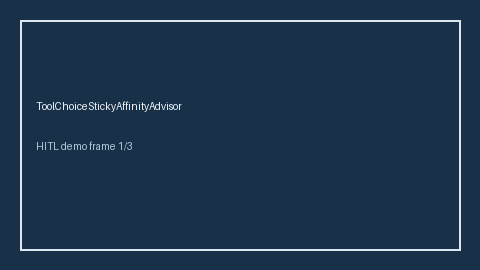

# ToolChoiceStickyAffinityAdvisor Guide



Offline HITL advisor. Never auto-acts. Closes gaps vs OpenRouter/LiteLLM/vLLM tool-choice sticky affinity advisors.

Optional later polish via **GPT-6 Astra / Claude Opus 5.5 / Gemini 4 Argon / Kimi K3.1 Pro**.

Distinct from ``StickyProviderRouter`` and ``StickySessionBleedAdvisor``.

## Usage

```python
from safety.tool_choice_sticky_affinity import ToolChoiceStickyAffinityAdvisor

advice = ToolChoiceStickyAffinityAdvisor().advise(request_id="r1", affinity_drift=0.2)
print(advice.band)
```

## Safety

No HTTP. Humans decide. See `SAFETY.md`.
