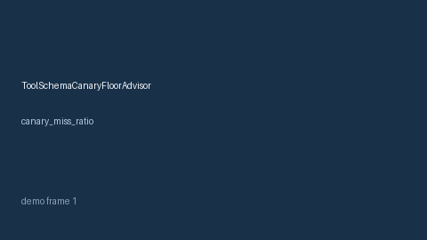

# ToolSchemaCanaryFloorAdvisor Guide



Offline HITL advisor for `canary_miss_ratio` bands. Gap vs vLLM/SGLang/LiteLLM tool-schema canary floor monitors. Distinct from `PromptInjectionCanaryFloorAdvisor` / `ProviderCanaryRolloutGuard`.

Optional polish via **GPT-5.5 / Claude Sonnet 4.6 / Gemini 3.x / Kimi K2**.

## Usage

```python
from safety.tool_schema_canary_floor import ToolSchemaCanaryFloorAdvisor

advice = ToolSchemaCanaryFloorAdvisor().advise(request_id="r1", canary_miss_ratio=0.1)
print(advice.band)
```

## Safety

Advisory only. No network I/O. Humans decide.
