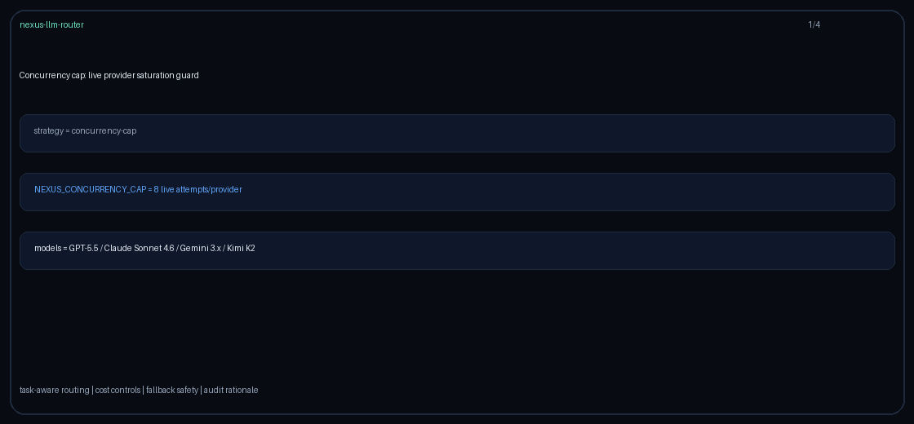

# vector-store-prefer Guide

Capability-aware routing for GPT-6 Astra / Claude Opus 5.5 / Gemini 4 Argon / Kimi K3.1 Pro.

## Why

OpenAI vector stores / RAG store affinity routing vs embeddings-only.

## Signals

Metadata keys: `requires_vector_store`, `vector_store`, `vector-store`; allowlist `vector_store_models`.
