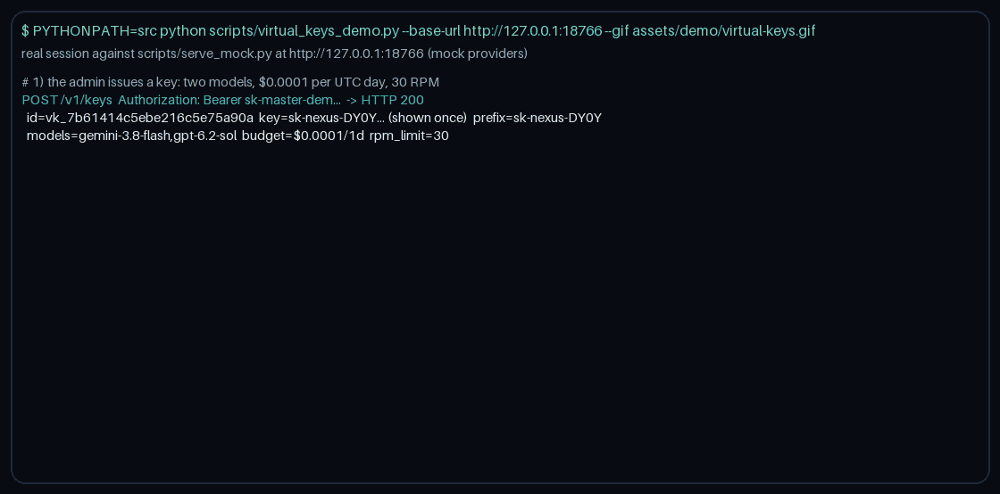

# Virtual Keys Guide (`NEXUS_AUTH_MODE=virtual_keys`, `/v1/keys`, `/v1/key/info`)



*A real session against `scripts/serve_mock.py` in `virtual_keys` mode (mock
providers, no provider API keys): the admin issues a key, the team calls the
Chat Completions and Messages APIs with it, a model outside the allowlist is
refused, the daily budget runs out (402), and the revoked key gets a 401
([how it was recorded](#how-the-demo-was-recorded)).*

Out of the box nexus is **open**: it fingerprints whatever `Authorization`
header arrives and serves the request, so anyone who can reach the gateway
spends your provider credit, and budgets are one global
`NEXUS_BUDGET_CAP_USD` per end user. **Virtual keys** turn nexus into a
multi-tenant gateway:

1. An administrator holding the **master key** (`NEXUS_MASTER_KEY`) issues
   gateway API keys (`sk-nexus-...`) through **`/v1/keys`**, one per team,
   app, or customer.
2. Each key carries its own **USD budget per UTC window** (`1h`, `1d`, `1mo`,
   ...), **model allowlist**, **requests-per-minute limit**, **expiry**,
   optional **tenant binding**, alias, and metadata. Keys can be **blocked**,
   **rotated**, and **revoked** (revoked keys stay listed for audit).
3. With `NEXUS_AUTH_MODE=virtual_keys`, **every model endpoint** admits only
   the master key and active virtual keys, routes only to the key's models,
   refuses requests its budget cannot cover, and attributes spend in the
   ledger and audit log to the **key id** (never the secret).
4. A key can read its own limits, window spend, remaining budget, and reset
   time with **`GET /v1/key/info`**.

**Who it is for:** platform teams that share one set of provider accounts
(OpenAI, Anthropic, Google, Moonshot) across teams or customers and need each
of them to have its own credential, spend cap, and model list, plus a way to
cut one of them off without touching the others.

## Contents

- [Why](#why)
- [How nexus compares](#how-nexus-compares)
- [Prerequisites](#prerequisites)
- [Quickstart (curl)](#quickstart-curl)
- [Using a key from the OpenAI and Anthropic SDKs](#using-a-key-from-the-openai-and-anthropic-sdks)
- [Admin API reference](#admin-api-reference)
- [Enforcement semantics](#enforcement-semantics)
- [Budgets and windows](#budgets-and-windows)
- [Model allowlists and routing](#model-allowlists-and-routing)
- [Rate limits, tenants, and attribution](#rate-limits-tenants-and-attribution)
- [How it interacts with existing features](#how-it-interacts-with-existing-features)
- [Configuration](#configuration)
- [Migrating from open mode](#migrating-from-open-mode)
- [Security notes](#security-notes)
- [Limitations and roadmap](#limitations-and-roadmap)
- [Troubleshooting](#troubleshooting)
- [FAQ](#faq)
- [How the demo was recorded](#how-the-demo-was-recorded)
- [Python API](#python-api)
- [Tests](#tests)

## Why

A gateway that cannot tell its callers apart cannot give them limits. Before
this feature, nexus treated any `Authorization` value as an identity: the key
fingerprint scoped idempotency, the response cache, and feedback, but every
caller was admitted, every model was reachable, and the only spend control was
one global per-user cap. `safety/virtual_keys.py` already held a hashed key
store, but nothing outside its own module used it.

Every popular LLM gateway makes issued keys its core multi-tenant feature,
because the alternatives are worse: handing each team a raw provider key gives
up central budgets, routing, caching, and audit; running one gateway per team
multiplies operations. Virtual keys keep one gateway and one set of provider
accounts while giving every caller its own policy.

## How nexus compares

| Capability | [LiteLLM proxy virtual keys](https://docs.litellm.ai/docs/proxy/virtual_keys) | [Portkey API keys / virtual keys](https://portkey.ai/docs/product/ai-gateway/virtual-keys) | [OpenRouter management API keys](https://openrouter.ai/docs/guides/overview/auth/management-api-keys) | nexus (this guide) |
| --- | --- | --- | --- | --- |
| Admin credential | `LITELLM_MASTER_KEY` | Admin / workspace API keys | Management API key (cannot call models) | `NEXUS_MASTER_KEY` (constant-time compare, never logged) |
| Issue / read / update / delete | `/key/generate`, `/key/info`, `/key/update`, `/key/delete`, `/key/block` | Dashboard and admin API | `POST/GET /api/v1/keys`, `GET/PATCH/DELETE /api/v1/keys/{hash}` | `POST/GET /v1/keys`, `GET/PATCH/DELETE /v1/keys/{key_id}`, `POST .../revoke`, `POST .../rotate` |
| Secret shown once, stored hashed | Yes | Yes | Yes | Yes: HMAC-SHA-256 under a server pepper; listings show `sk-nexus-XXXX` |
| Budget with reset window | `max_budget` + `budget_duration` (`30s` ... `1mo`) | Budget limits (periodic reset) | `limit` + `limit_reset` (daily / weekly / monthly, UTC) | `max_budget_usd` + `budget_duration` (`30m` ... `1mo`, fixed UTC windows) |
| Model allowlist | `models` | Per-key model config | Workspace guardrails | `models`; routing and fallbacks stay inside it |
| Rate limits | `rpm_limit`, `tpm_limit` | Rate limits (requests / tokens) | Account-level | `rpm_limit` (TPM on the roadmap) |
| Expiry, blocking, revocation | `duration` / `expires`, `blocked` | Expiry, disable | `expires_at`, `disabled`, delete | `expires_at`, `blocked`, soft revoke (kept for audit), rotation |
| Self-service key info | `/key/info` | Dashboard | `GET /api/v1/key` | `GET /v1/key/info` (window spend, remaining, reset time) |
| Spend per key | DB spend logs | Analytics | Usage per key | Durable spend ledger (`api_key_id`) + audit log |
| Storage | Postgres | Hosted | Hosted | SQLite next to the spend ledger; no extra service |

What nexus adds on top: allowlists are enforced *inside the router*
(automatic routing and every fallback stay on allowed models, see
[Model allowlists and routing](#model-allowlists-and-routing)), budgets are
checked against the same per-candidate cost forecast the router already uses,
and enforcement covers the OpenAI Chat Completions, OpenAI Responses, and
Anthropic Messages APIs alike.

## Prerequisites

- nexus from this repository (`uv sync` or `pip install -e '.[dev]'`).
- A master key of at least 16 characters, for example `openssl rand -hex 32`.
- Recommended: a hashing pepper of at least 16 characters
  (`NEXUS_KEY_HASH_PEPPER`), kept as secret as the master key.

No provider keys are needed to try it: `scripts/serve_mock.py` serves the real
HTTP API with deterministic mock providers.

## Quickstart (curl)

Start nexus in `virtual_keys` mode (here with mock providers):

```bash
export NEXUS_AUTH_MODE=virtual_keys
export NEXUS_MASTER_KEY=sk-master-demo-0123456789abcdef   # use: openssl rand -hex 32
export NEXUS_KEY_HASH_PEPPER=demo-pepper-0123456789abcdef  # use: openssl rand -hex 32
PYTHONPATH=src python scripts/serve_mock.py --port 18766 &
```

Issue a key for the search team: GPT-6.2 Sol and Gemini 3.8 Flash only, $25 per
30-day window, 60 requests per minute. **The response is the only time the
secret `key` is shown**; store it in your secret manager.

```bash
curl -s localhost:18766/v1/keys \
  -H "Authorization: Bearer $NEXUS_MASTER_KEY" -H 'content-type: application/json' \
  -d '{"alias": "search-team", "models": ["gpt-6.2-sol", "gemini-3.8-flash"],
       "max_budget_usd": 25, "budget_duration": "30d", "rpm_limit": 60,
       "metadata": {"owner": "search@acme.example"}}'
```

```json
{"id":"vk_0a23df5befcf5904ee0098a0","object":"virtual_key","key_prefix":"sk-nexus-iCAe","status":"active","alias":"search-team","tenant":null,"models":["gemini-3.8-flash","gpt-6.2-sol"],"max_budget_usd":25.0,"budget_duration":"30d","rpm_limit":60,"expires_at":null,"blocked":false,"metadata":{"owner":"search@acme.example"},"created_at":1795806600,"updated_at":1795806600,"revoked_at":null,"spend":{"window_start":1793664000,"resets_at":1796256000,"spend_usd":0.0,"remaining_usd":25.0,"total_spend_usd":0.0,"request_count":0},"key":"sk-nexus-iCAe…(43 random characters)"}
```

Call any model endpoint with the key, exactly as with a provider key:

```bash
export SEARCH_KEY=sk-nexus-...   # the "key" from the response above
curl -s localhost:18766/v1/chat/completions \
  -H "Authorization: Bearer $SEARCH_KEY" -H 'content-type: application/json' \
  -d '{"model": "auto", "messages": [{"role": "user", "content": "Draft a two-line release note."}], "max_tokens": 64}' \
  | jq -c '{model, cost: .router.cost_usd, rationale: .router.rationale}'
```

```json
{"model":"gemini-3.8-flash","cost":0.000023,"rationale":"simple realtime prompt favors low latency"}
```

The key reads its own limits and spend:

```bash
curl -s localhost:18766/v1/key/info -H "Authorization: Bearer $SEARCH_KEY" \
  | jq -c '{id, status, models, max_budget_usd, budget_duration, rpm_limit, spend}'
```

```json
{"id":"vk_0a23df5befcf5904ee0098a0","status":"active","models":["gemini-3.8-flash","gpt-6.2-sol"],"max_budget_usd":25.0,"budget_duration":"30d","rpm_limit":60,"spend":{"window_start":1793664000,"resets_at":1796256000,"spend_usd":0.000023,"remaining_usd":24.999977,"total_spend_usd":0.000023,"request_count":1}}
```

Requests outside the key's policy fail before any provider is called (these
are `/v1/responses` calls, which use the OpenAI error envelope):

```text
model=claude-opus-5-5                 HTTP 403 {"error":{"message":"This API key may not use model 'claude-opus-5-5'. Allowed models: gemini-3.8-flash, gpt-6.2-sol.","type":"permission_error","param":"model","code":"model_not_allowed"}}
budget used up for today              HTTP 402 {"error":{"message":"API key budget exhausted: $0.000023 of $0.000020 spent in the budget window that resets at 2026-11-28T00:00:00Z.","type":"budget_exceeded","param":null,"code":"budget_exceeded"}}
second request in a minute (rpm 1)    HTTP 429 {"error":{"message":"Rate limit reached for API key vk_0a23df5befcf5904ee0098a0: 1 request per minute.","type":"rate_limit_error","param":null,"code":"rate_limit_exceeded"}}
after rotation, the old secret        HTTP 401 {"error":{"message":"Invalid API key: this gateway did not issue it.","type":"authentication_error","param":null,"code":"invalid_api_key"}}
no key at all                         HTTP 401 {"error":{"message":"Missing API key: send it as 'Authorization: Bearer <key>' or 'x-api-key: <key>'.","type":"authentication_error","param":null,"code":"invalid_api_key"}}
```

Revoke the key when the team no longer needs it; it answers 401 at once and
stays listed (`status: revoked`) with its spend:

```bash
curl -s -X DELETE localhost:18766/v1/keys/vk_0a23df5befcf5904ee0098a0 \
  -H "Authorization: Bearer $NEXUS_MASTER_KEY" | jq -c '{id, status, revoked_at}'
```

## Using a key from the OpenAI and Anthropic SDKs

A virtual key is a drop-in API key. Send it as `Authorization: Bearer <key>`
or as `x-api-key: <key>` on any endpoint (when both headers are present they
must carry the same key, otherwise the request is a 401).

```python
from openai import OpenAI
from anthropic import Anthropic

openai_client = OpenAI(base_url="http://localhost:18766/v1", api_key="sk-nexus-...")
reply = openai_client.chat.completions.create(
    model="gpt-6.2-sol",  # a model on the key's allowlist, or "auto" to let nexus route
    messages=[{"role": "user", "content": "Draft a two-line release note."}],
)

anthropic_client = Anthropic(base_url="http://localhost:18766", api_key="sk-nexus-...")
message = anthropic_client.messages.create(
    model="auto", max_tokens=256, messages=[{"role": "user", "content": "Hello"}]
)
```

## Admin API reference

All `/v1/keys*` endpoints require the **master key** (as `Authorization:
Bearer` or `x-api-key`). A missing or invalid credential is a **401**
`invalid_api_key` (also for revoked, expired, or blocked virtual keys, with
their own codes), a valid virtual key is a **403** `permission_denied`, and
without `NEXUS_MASTER_KEY` the admin API is disabled (**403**). Credentials are
checked before the request body is validated. Errors use the OpenAI envelope
`{"error": {"message", "type", "param", "code"}}`; validation errors are
**400**s naming the parameter.

The admin API works in both auth modes, so you can issue keys before you turn
enforcement on (see [Migrating from open mode](#migrating-from-open-mode)).

### The `virtual_key` object

| Field | Type | Meaning |
| --- | --- | --- |
| `id` | string | Key id, `vk_` plus 24 hex characters. Used in URLs, the spend ledger, and the audit log. Not secret. |
| `object` | string | Always `virtual_key`. |
| `key_prefix` | string | `sk-nexus-` plus the first 4 random characters of the secret, to recognize a key. Not secret. |
| `key` | string | **Only in the create and rotate responses**: the secret. |
| `status` | string | `active`, `blocked`, `expired`, or `revoked` (revoked > expired > blocked). |
| `alias` | string or null | Free-text label (≤ 64 printable characters). |
| `tenant` | string or null | Tenant the key is bound to (≤ 128 characters); see [tenants](#rate-limits-tenants-and-attribution). |
| `models` | list | Allowed catalog model ids; `[]` allows every model. |
| `max_budget_usd` | number or null | Budget per `budget_duration` window, or for the key's lifetime; `null` is unlimited. |
| `budget_duration` | string or null | Budget window (`30m`, `1h`, `1d`, `1w`, `1mo`, ...); `null` is a lifetime budget. |
| `rpm_limit` | integer or null | Requests per minute; `null` is unlimited. |
| `expires_at` | integer or null | Unix time after which the key is a 401. |
| `blocked` | boolean | Temporarily disabled (reversible). |
| `metadata` | object | Your JSON (≤ 4,096 bytes). |
| `created_at`, `updated_at`, `revoked_at` | integer / null | Unix times. |
| `spend` | object | `window_start` and `resets_at` (Unix times, `null` for lifetime budgets), `spend_usd` (this window), `remaining_usd` (`null` without a budget), `total_spend_usd` and `request_count` (lifetime). |

### `POST /v1/keys`

Issue a key. Every field is optional; unknown fields are a 400
`unknown_parameter`.

| Field | Default | Rules |
| --- | --- | --- |
| `alias` | `null` | 1-64 printable characters. |
| `tenant` | `null` | 1-128 printable characters. |
| `models` | `null` (all) | Up to 256 ids, each a model in this gateway's catalog (`GET /v1/models` with the master key). |
| `max_budget_usd` | `null` | Number ≥ 0 (`0` freezes spending). |
| `budget_duration` | `null` | `<count><unit>`, count 1-9999, unit `m`, `h`, `d`, `w`, or `mo`. |
| `rpm_limit` | `null` | Integer 1-1,000,000. |
| `expires_at` | `null` | ISO 8601 (naive means UTC) or Unix seconds; must be in the future. |
| `metadata` | `{}` | JSON object, ≤ 4,096 bytes serialized. |
| `blocked` | `false` | `true` issues the key blocked. |

Returns the `virtual_key` object **with `key`** (HTTP 200).

### `GET /v1/keys`

List keys newest first, without secrets. Revoked keys are included unless you
filter them out.

| Query | Meaning |
| --- | --- |
| `alias`, `tenant` | Exact match. |
| `blocked`, `expired`, `revoked` | `true` / `false` filters. |
| `limit` | Page size 1-100, default 20. |
| `offset` | Keys to skip, default 0. |

Returns `{"object": "list", "data": [...], "total": N, "limit": L, "offset": O, "has_more": bool}`.

### `GET /v1/keys/{key_id}`

One key with its current spend; **404** `key_not_found` for an unknown id.

### `PATCH /v1/keys/{key_id}`

Change any of the create fields. Present fields are applied, omitted fields are
kept, and `null` clears a limit (`"models": null` allows every model again,
`"max_budget_usd": null` removes the budget, `"expires_at": null` makes the key
permanent). `blocked: true` / `false` blocks or unblocks the key. An
`expires_at` in the past expires the key at once. Revoked keys are final:
**409** `key_revoked`.

### `DELETE /v1/keys/{key_id}` and `POST /v1/keys/{key_id}/revoke`

Revoke a key for good. It answers 401 `api_key_revoked` from the next request
on, keeps its id and spend history, and stays in listings with `status:
revoked` and `revoked_at`. Revoking again returns the same object.

### `POST /v1/keys/{key_id}/rotate`

Issue a new secret for the same key: id, limits, and spend are kept, the old
secret is a 401 `invalid_api_key` immediately, and the response carries the new
`key` (once). Revoked keys cannot be rotated (409).

### `GET /v1/key/info`

Called with a virtual key (not the master key, which gets a 400
`not_a_virtual_key`): returns the caller's own `virtual_key` object without the
secret, including `spend.spend_usd`, `spend.remaining_usd`, and
`spend.resets_at`. It is not metered (no budget or RPM is used).

### Error codes

| HTTP | `type` | `code` | When |
| --- | --- | --- | --- |
| 401 | `authentication_error` | `invalid_api_key` | No key, a key this gateway did not issue, a rotated-out secret, or `Authorization` and `x-api-key` carrying different keys. |
| 401 | `authentication_error` | `api_key_revoked` / `api_key_expired` / `api_key_blocked` | The key was revoked, is past `expires_at`, or is blocked. |
| 403 | `permission_error` | `permission_denied` | A virtual key on the admin API or on `POST /v1/spend`; the admin API without `NEXUS_MASTER_KEY`. |
| 403 | `permission_error` | `model_not_allowed` | The request names a catalog model outside the key's `models`. |
| 403 | `permission_error` | `no_eligible_model` | None of the key's `models` is in the catalog any more. |
| 403 | `permission_error` | `tenant_mismatch` | `X-Tenant-Id` names another tenant than the key is bound to. |
| 402 | `budget_exceeded` | `budget_exceeded` | The key's window budget is used up, or no allowed model's estimated cost fits what is left. |
| 503 | `server_error` | `spend_unsettled` | An earlier request's spend could not be written to the spend ledger and still cannot; the key may spend again once it is recorded. |
| 429 | `rate_limit_error` | `rate_limit_exceeded` | The key's `rpm_limit` is reached. |
| 400 | `invalid_request_error` | `invalid_value` / `unknown_parameter` / `missing_required_parameter` | Admin API validation (`param` names the field). |
| 400 | `invalid_request_error` | `not_a_virtual_key` | `GET /v1/key/info` with the master key. |
| 404 | `invalid_request_error` | `key_not_found` | Unknown `key_id`. |
| 409 | `invalid_request_error` | `key_revoked` | Updating or rotating a revoked key. |

## Enforcement semantics

With `NEXUS_AUTH_MODE=virtual_keys` every request is admitted in this order,
and a refusal at any step happens **before any provider is called** (refusals
at steps 1-3 also leave the key's budget and RPM limit untouched):

1. **Credential**: the master key, or an active virtual key (401 otherwise).
2. **Tenant binding**: `X-Tenant-Id` must match a tenant-bound key (403), on
   every endpoint.
3. **Models**: a `model` that names a catalog model outside the allowlist is a
   403; an allowlist with no catalog model left is a 403 `no_eligible_model`.
4. **Budget** (endpoints that can spend): spend settled in the current window
   must be below `max_budget_usd` (402). If an earlier request's ledger write
   failed, nexus first retries it and answers 503 `spend_unsettled` while it
   still fails, rather than checking the budget against stale totals.
5. **RPM** (endpoints that can spend): one request from the key's bucket (429).
6. The existing gateway guards: the `X-Tenant-Id` rate limit, `Idempotency-Key`
   replays, and the response cache, all scoped per key.
7. **Routing**: the strategy's decision and fallback chain are restricted to
   the allowlist, and each candidate whose estimated cost exceeds the key's
   remaining budget is skipped (402 when that skips them all).
8. **Settlement**: the provider's real cost is written to the spend ledger with
   the key id, which the next request's budget check reads.

| Endpoint | Credential | Allowlist | Budget / RPM | Error envelope |
| --- | --- | --- | --- | --- |
| `POST /v1/chat/completions` (incl. `stream`) | Key or master | 403 for a disallowed catalog `model`; routing restricted | Yes | FastAPI `{"detail": "<message>"}`, like every chat error |
| `POST /v1/responses` (incl. `stream`) | Key or master | Same | Yes | OpenAI `{"error": {...}}` |
| `POST /v1/messages` (incl. `stream`) | Key or master (`x-api-key` or `Authorization`) | Same | Yes | Anthropic `{"type": "error", ...}` (401 `authentication_error`, 402 `billing_error`, 403 `permission_error`, 429 `rate_limit_error`) |
| `POST /v1/messages/count_tokens` | Key or master | 403 for a disallowed `model` | No | Anthropic |
| `POST /v1/feedback`, `GET /v1/feedback/summary` | Key or master | - | No | OpenAI |
| `GET /v1/models`, `GET /v1/models/{id}` | Key or master | Lists only allowed models; others are 404 `model_not_found` | No | OpenAI |
| `GET /v1/spend` | Key or master | - | No | OpenAI; a virtual key sees only its own requests, the master key all of them |
| `POST /v1/spend` | Master only (403 for keys) | - | No | OpenAI |
| `/v1/keys*` | Master only | - | No | OpenAI |
| `GET /v1/key/info` | Virtual key | - | No | OpenAI |
| `GET /health`, `GET /metrics` | None | - | No | Operational endpoints: keep them on a private network or behind your ingress auth. |

The master key is admitted everywhere without limits (its requests are
attributed to the id `master`). Streams are admitted before the first byte, so
admission errors are plain HTTP errors. A chat completion stream whose every
candidate the budget forecast refuses ends with a `budget_exceeded` error frame,
the same as for the global budget cap; Responses and Messages streams return
the 402 before streaming.

## Budgets and windows

- **What counts:** the real cost the router records in the spend ledger for
  each completed request made with the key (catalog prices for models the
  provider adapter cannot price). Cache hits and idempotent replays cost
  nothing.
- **Before dispatch:** a key whose window spend has reached `max_budget_usd`
  gets a 402 `budget_exceeded` without routing. Otherwise the router skips
  every candidate model whose estimated cost (prompt estimate plus
  `max_tokens` at catalog prices, the same forecast the global budget guardrail
  uses) exceeds what is left, and fails with 402 when it skips them all.
- **After dispatch:** the response's real cost settles in the ledger. Estimates
  assume the answer uses all of `max_tokens`, so a key usually stops a little
  before its budget; a request can take it past the budget when the provider
  reports more input tokens than nexus estimated.
- **Windows are fixed UTC windows**, the same on every worker and restart:

| `budget_duration` | Window |
| --- | --- |
| `30m`, `1h`, `6h` | Aligned to the Unix epoch: `1h` starts on the hour (UTC), `6h` at 00:00, 06:00, 12:00, 18:00 UTC. |
| `1d`, `7d`, `30d` | `1d` runs from 00:00 UTC to 00:00 UTC; `Nd` windows are epoch-aligned blocks of N days. |
| `1w`, `2w` | Start on Mondays at 00:00 UTC. |
| `1mo`, `3mo`, `12mo` | Start on the first day of a month at 00:00 UTC (`3mo` gives calendar quarters, `12mo` calendar years). |
| `null` | No reset: `max_budget_usd` is a lifetime budget. |

`spend.window_start` and `spend.resets_at` in every key object show the
current window. Use `1mo` rather than `30d` for calendar months.

- **Changing a budget** takes effect on the next request; lowering it below
  the window's spend blocks the key until the window resets.
- **Concurrency:** settlement is a durable ledger row per request (SQLite with
  one row per response, so concurrent workers never lose spend), and the
  admission check reads the settled spend. Requests already in flight when the
  budget runs out still complete and are billed: a key can overshoot by at most
  the cost of its concurrent requests. Cap concurrency with `rpm_limit` when
  that matters; in-flight reservations are on the
  [roadmap](#limitations-and-roadmap).
- **Ledger write failures:** if recording a response's cost fails (a locked
  or full disk), the answer is still returned and the row is kept in memory.
  The key's next request that can spend retries the write first and gets a
  503 `spend_unsettled` while it keeps failing, so a broken ledger never lets
  a key spend on stale totals. Rows kept in memory are lost if the process
  restarts before they are written (the `spend_ledger_write_failed` warning
  carries the request id, key id, and cost for reconciliation).
- The global `NEXUS_BUDGET_CAP_USD` guardrail still applies on top of key
  budgets (whichever refuses first wins).

## Model allowlists and routing

- `models: []` (or `null`) allows every catalog model; otherwise only the
  listed models are reachable.
- **An explicit model** (`"model": "claude-opus-5-5"`) that is a catalog model
  outside the allowlist is a 403 `model_not_allowed`, on every endpoint
  including `count_tokens`.
- **Routing hints stay hints:** a `model` that is not a catalog model (such as
  `auto`) is handled as in open mode, by the routing strategy, but only among
  the key's models.
- **Automatic routing and fallbacks stay inside the allowlist.** When a
  strategy chooses a disallowed model (for example the rule-based policy
  sending a medical prompt to Claude Opus 5.5), the key's allowed models take
  its place in strategy order, then by quality prior, and the routing rationale
  says so: `"...; claude-opus-5-5 is not allowed for this API key, so routed to
  gpt-6.2-sol"`. The fallback chain keeps its length but never contains a
  disallowed model, so a failing allowed provider gives a 503 rather than a
  call to a model the key may not use.
- `GET /v1/models` lists only the allowed models, and `GET /v1/models/{id}`
  answers 404 for the others, so model pickers in client apps show the right
  list.
- Allowlists are validated against the catalog when you create or update a
  key. If a later deployment drops every model of a key from the catalog,
  its requests get 403 `no_eligible_model` until you update it.

## Rate limits, tenants, and attribution

- **`rpm_limit`** is a token bucket per key: up to N requests at once,
  refilling at N per minute. Only endpoints that can spend use it (chat,
  responses, messages); model listings, key info, token counts, spend reads,
  and feedback do not. Like the other nexus rate limiters it is per process;
  with several workers each enforces the limit separately.
- **Tenant binding:** a key created with `tenant` attributes every request to
  that tenant (the `X-Tenant-Id` rate limit, audit log, cache, idempotency, and
  feedback scopes) and rejects an `X-Tenant-Id` naming another tenant (403
  `tenant_mismatch`). Keys without a tenant keep using `X-Tenant-Id` as today.
- **Attribution:** the spend ledger row (`api_key_id`), the audit log record
  (`api_key_id`, `tenant_id`), the structured logs of key administration
  (`virtual_key_created`, `..._updated`, `..._revoked`, `..._rotated`), and
  feedback scopes all carry the **key id** (`vk_...`), never the secret.
  Rotation keeps the id, so history and feedback rights survive it.

## How it interacts with existing features

| Feature | With virtual keys |
| --- | --- |
| `Idempotency-Key` | Replays are scoped to the key id, `X-Tenant-Id`, and end user, exactly as they were scoped to the key fingerprint. Another key never receives your replay. Admission runs first, so a revoked, expired, blocked, over-budget, or rate-limited key gets its error instead of the replay. A replay returns the response of the request that already ran (and was billed) under the key's policy at that time, so narrowing the allowlist does not re-route it (that would run and bill the request twice); a retry that names a now-disallowed catalog model gets the 403. |
| Response cache | The cache namespace is the key id, tenant, principal, and the key's allowlist, serialized as JSON so client-chosen ids cannot spell another namespace: narrowing an allowlist never serves a new request from a model the key may no longer use. |
| Feedback (`/v1/feedback`) | Only the key (and tenant) that made a request can rate it; other keys get 404. |
| Global budget cap (`NEXUS_BUDGET_CAP_USD`) | Unchanged, per end user (`user` / `metadata.user_id`) or per key id when no end user is sent. |
| `X-Tenant-Id` rate limit | Unchanged; tenant-bound keys use their tenant. |
| `GET /v1/spend` | Scoped to the calling key; the master key sees everything. |
| Open mode | Unchanged: no key is required, any `Authorization` is fingerprinted, `/v1/models` is unfiltered. |

## Configuration

| Variable | Default | Meaning |
| --- | --- | --- |
| `NEXUS_AUTH_MODE` | `open` | `open` keeps today's behaviour; `virtual_keys` admits only the master key and issued keys on every model endpoint. |
| `NEXUS_MASTER_KEY` | unset | Admin credential for `/v1/keys*` (≥ 16 characters). **Required** with `virtual_keys` (startup fails without it); optional in `open` mode, where it enables the admin API. |
| `NEXUS_VIRTUAL_KEYS_PATH` | `migrations/virtual-keys.sqlite3` | SQLite key store (hashes and limits only). Put it on durable storage next to `NEXUS_SPEND_LEDGER_PATH`; every worker must share both. |
| `NEXUS_KEY_HASH_PEPPER` | unset | Secret (≥ 16 characters) keying the HMAC of every key. Without it nexus uses a public constant and logs `virtual_keys_unpeppered` at startup. **Changing it invalidates every issued key.** |

Spend per key lives in the existing spend ledger (`NEXUS_SPEND_LEDGER_PATH`),
which gains an `api_key_id` column in place; older rows keep `NULL`.

## Migrating from open mode

1. **Keep `NEXUS_AUTH_MODE=open`** and set `NEXUS_MASTER_KEY` (and
   `NEXUS_KEY_HASH_PEPPER`). Restart: the admin API is now available, nothing
   else changes.
2. **Issue one key per caller** with `POST /v1/keys`, starting with generous
   limits (no budget, every model) and an `alias` naming the owner.
3. **Roll the keys out**: callers replace whatever placeholder they sent as
   `Authorization` / `x-api-key`. In open mode nexus still only fingerprints
   them, so this is safe at any pace.
4. **Turn enforcement on** with `NEXUS_AUTH_MODE=virtual_keys` and restart.
   Callers without an issued key now get 401; callers with one keep working.
5. **Tighten limits** per key with `PATCH /v1/keys/{key_id}` (budget, window,
   models, RPM, expiry) while watching `GET /v1/keys` and `GET /v1/spend`.

Spend recorded in open mode is attributed to the key *fingerprint* (`key_...`),
not the key id, so it does not count toward the new keys' budgets. To roll
back, set `NEXUS_AUTH_MODE=open` again; the key store is kept.

## Security notes

- **Secrets:** 256 random bits (`secrets.token_urlsafe(32)`) behind the
  `sk-nexus-` prefix, returned only by create and rotate. The store keeps an
  **HMAC-SHA-256** of each secret under `NEXUS_KEY_HASH_PEPPER`, looked up by
  digest and compared with `hmac.compare_digest`. A fast keyed hash is the
  right tool for high-entropy random secrets (salted slow hashes defend
  low-entropy passwords against guessing, which 256-bit keys do not need);
  the pepper means a stolen copy of the database cannot even confirm a
  leaked key. Rows from the original plain-SHA-256 store keep working.
- **Master key:** a `SecretStr` setting (masked in reprs and validation
  errors), compared in constant time via fixed-length SHA-256 digests, never
  logged, and never accepted as a virtual key. Rotate it by changing
  `NEXUS_MASTER_KEY` and restarting; issued keys are unaffected.
- **Logs and storage:** the gateway logs and stores key ids and the 4-character
  display prefix only. The secret never reaches the spend ledger, audit log,
  response cache, idempotency store, feedback store, structured logs, or error
  messages (unknown keys are reported as "this gateway did not issue it"
  without echoing them).
- **Errors leak nothing:** credentials are checked before admin request bodies
  are validated; a non-admin key learns only that it is not the master key.
- **Revocation is immediate and final** across workers (the store is shared);
  use `blocked` for a reversible stop and rotation for a suspected leak.
- **Not covered:** `/health` and `/metrics` stay unauthenticated, TLS is your
  ingress's job, and RPM state is per process. See [SAFETY.md](../../SAFETY.md#virtual-keys).

## Limitations and roadmap

- **In-flight budget reservations:** budgets are checked against settled
  spend, so concurrent requests can overshoot by their own cost (see
  [Budgets and windows](#budgets-and-windows)).
- **TPM limits** (`tpm_limit`) and `max_parallel_requests` are not implemented
  yet; `rpm_limit` is per process.
- **Per-key Prometheus metrics** are not exported (key ids are unbounded label
  values); use `GET /v1/keys` and `GET /v1/spend`.
- **Teams, users, and SSO-backed admin roles** (LiteLLM's `/team/*`,
  `/user/*`) are out of scope: there is one master key.
- **Budget alerts** (soft limits, webhooks) are not sent.
- **Provider credentials per key** (Portkey-style vaults) are not stored: keys
  share the gateway's provider configuration.

## Troubleshooting

| Symptom | Cause and fix |
| --- | --- |
| nexus exits at startup with `NEXUS_MASTER_KEY is required when NEXUS_AUTH_MODE=virtual_keys` | Set a master key of at least 16 characters. |
| Every key is suddenly a 401 `invalid_api_key` | `NEXUS_KEY_HASH_PEPPER` or `NEXUS_VIRTUAL_KEYS_PATH` changed, or workers use different stores. Restore the old values. |
| 403 `model_not_allowed` although the model looks right | The request names a catalog model outside `models`; check `GET /v1/key/info`, send an allowed model or `auto`. |
| 403 `no_eligible_model` | The catalog no longer has any of the key's models; `PATCH` its `models`. |
| 402 although `remaining_usd` is positive | The remainder cannot cover any allowed model's estimate; lower `max_tokens`, raise the budget, or wait for `resets_at`. |
| 429 `rate_limit_exceeded` with a low request rate | Several clients share the key, or the key's `rpm_limit` is lower than you think (`GET /v1/key/info`). |
| `GET /v1/spend` shows only part of the traffic | Virtual keys see only their own requests; use the master key for totals. |
| 403 from `/v1/keys` with the master key | `NEXUS_MASTER_KEY` is unset on that worker (the admin API is then disabled). |

## FAQ

**Can a virtual key call the admin API?** No: it is a 403 `permission_denied`.
Only the master key manages keys.

**Can the master key call models?** Yes, without limits; its requests are
attributed to `master`. Prefer issued keys for applications.

**Is a budget hard?** It is checked before every request against settled
spend and the router's forecast; see the concurrency note above.

**What happens to cached answers when I narrow a key's models?** They are not
replayed: the cache namespace includes the allowlist.

**Do keys work in open mode?** They are accepted like any other credential
(fingerprinted, no limits). Their limits apply once `virtual_keys` is on.

**How do I delete a key's history?** Revoke it; rows are kept for audit by
design. Remove ledger rows with your own retention job if your policy requires.

## How the demo was recorded

The GIF is the printed transcript of a real session, rendered with the shared
helpers in `scripts/create_demo_gif.py` (secrets masked):

```bash
export NEXUS_AUTH_MODE=virtual_keys NEXUS_MASTER_KEY=sk-master-demo-0123456789abcdef
export NEXUS_KEY_HASH_PEPPER=demo-pepper-0123456789abcdef
PYTHONPATH=src python scripts/serve_mock.py --port 18766 &
PYTHONPATH=src python scripts/virtual_keys_demo.py --base-url http://127.0.0.1:18766 --gif assets/demo/virtual-keys.gif
```

```text
# 1) the admin issues a key: two models, $0.0001 per UTC day, 30 RPM
POST /v1/keys  Authorization: Bearer sk-master-dem...  -> HTTP 200
  id=vk_7b61414c5ebe216c5e75a90a  key=sk-nexus-DY0Y... (shown once)  prefix=sk-nexus-DY0Y
  models=gemini-3.8-flash,gpt-6.2-sol  budget=$0.0001/1d  rpm_limit=30
# 2) the team calls nexus with its key (OpenAI and Anthropic APIs)
POST /v1/chat/completions  -> 200  model=gemini-3.8-flash  cost=$0.000018
POST /v1/messages  x-api-key  -> 200  model=gemini-3.8-flash
# 3) the model allowlist: other catalog models are refused and hidden
POST /v1/chat/completions  model=claude-opus-5-5  -> 403  This API key may not use model 'claude-opus-5-5'. Allowed models: gemini-3.8-flash, gpt-6.2-sol.
GET /v1/models  -> gemini-3.8-flash, gpt-6.2-sol
# 4) spend settles from each answer's real cost until the forecast refuses
chat  -> 200  spent=$0.000054  remaining=$0.000046
chat  -> 200  spent=$0.000072  remaining=$0.000028
chat  -> 402  API key budget exceeded for vk_7b61414c5ebe216c5e75a90a: gpt-6.2-sol is estimated at $0.000100 and $0.000028 is left in the budget window
# 5) GET /v1/key/info: the key's own limits, spend, and reset time
status=active  requests=4  window spend=$0.000072  remaining=$0.000028  resets_at=2026-11-28T00:00Z
# 6) the admin revokes the key: 401 at once, still listed for audit
DELETE /v1/keys/vk_7b61414c5ebe216c5e75a90a  -> status=revoked
chat  -> 401  This API key has been revoked.
GET /v1/keys?revoked=true  -> vk_7b61414c5ebe216c5e75a90a  status=revoked  spend=$0.000072
```

Mock providers bill $0.001 per 1,000 tokens, while the forecast uses catalog
prices, which is why the third call is refused with budget left: the cheapest
allowed model's estimate no longer fits.

## Python API

`safety.virtual_keys.VirtualKeyStore` is usable on its own (its original
`create` / `authenticate` / `assert_model_allowed` / `assert_budget` API is
unchanged):

```python
from safety.virtual_keys import VirtualKeyStore, budget_window

store = VirtualKeyStore("migrations/virtual-keys.sqlite3", pepper="<NEXUS_KEY_HASH_PEPPER>")
secret, key = store.create(
    alias="search-team", allowed_models=["gpt-6.2-sol"], max_budget_usd=25.0, budget_duration="1mo"
)
key = store.authenticate(secret)          # InvalidVirtualKeyError(reason=...) when unusable
store.assert_model_allowed(key, "gpt-6.2-sol")
start, resets_at = budget_window(key.budget_duration, now=1795806600.0)
store.update(key.key_id, {"rpm_limit": 120, "enabled": False})  # block
new_secret, key = store.rotate(key.key_id)
store.revoke(key.key_id)
```

`api.keys.KeyGate` (admission) and `api.keys.KeyAdmin` (the admin endpoints)
wrap it for the HTTP API; `router.schemas.KeyLimits` carries a key's
allowlist and remaining budget into `NexusRouter`.

## Tests

- `tests/test_virtual_keys.py`: hashing and prefixes, legacy rows, expiry,
  blocking, rotation, revocation, validation, fixed UTC windows and their
  boundaries, listing, the RPM bucket, and concurrent settlement in SQLite.
- `tests/test_virtual_keys_api.py`: the admin API (auth, validation,
  list / get / update / revoke / rotate, key info) and enforcement on every
  endpoint (401 per key state with no provider call, allowlists on explicit
  models and routed fallbacks, budget 402s per envelope, window resets, RPM
  429s, `/v1/models` filtering, `/v1/spend` scoping, ledger and audit
  attribution, idempotency / cache / feedback scoping, tenant binding, and
  open mode unchanged).
